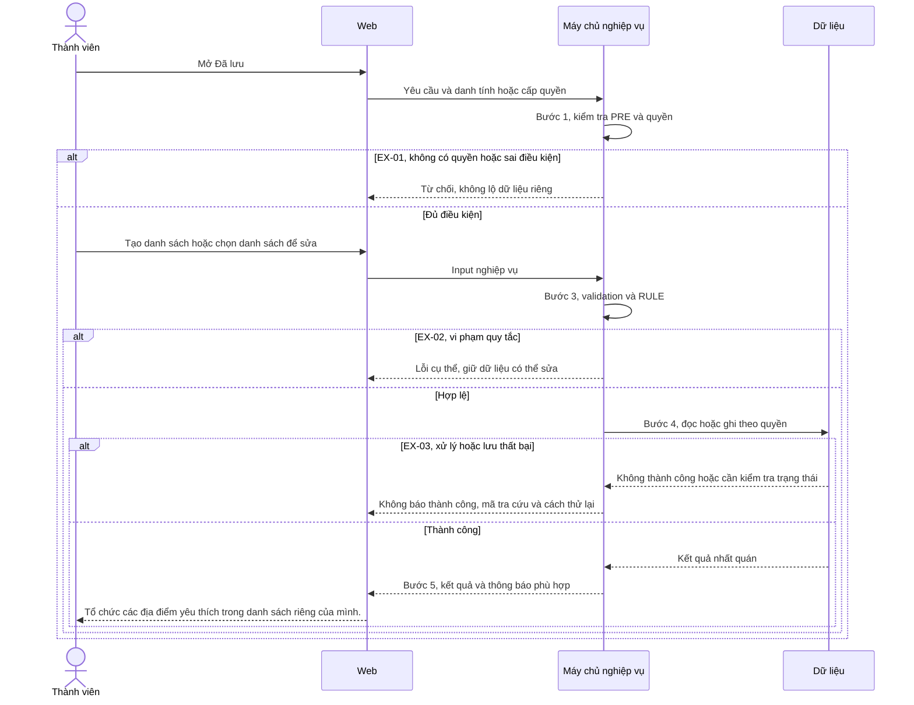

# UC-006: Quản lý danh sách đã lưu

**Version:** 1.1 — 15-11-2026  
**Status:** Draft, chờ duyệt nghiệp vụ; chưa tự coi các PROP/TBD là baseline.  
**Requirement chính:** [GWB-REQ-G1 v1.1](../requirements/GoWithBae_Requirements_G1_v1.1.md)  
**Nguồn khách hàng:** §5.1/F05  
**Truy vết:** FR-09, FR-22; AC-011, AC-012.

## 1. Overview

| Trường | Nội dung |
|---|---|
| Goal | Tổ chức các địa điểm yêu thích trong danh sách riêng của mình. |
| Primary Actor | Thành viên |
| Secondary Actors | Máy chủ GoWithBae; dịch vụ email/bản đồ/tệp/lịch chỉ khi thao tác tương ứng cần tích hợp, theo requirement §7 |
| Trigger | Mở Đã lưu |
| Scope IN | Quản lý danh sách đã lưu trên web G1 theo các FR liên kết |
| Scope OUT | Chức năng G2, đặt chỗ/thanh toán/app/AI/chat; quyền và thao tác ngoài mục tiêu UC. Điều hướng sang UC khác không tự thực hiện UC đó. |

## 2. Preconditions

- PRE-1: Có phiên thành viên được phép tạo/sửa. Enforce tại bước 1; kiểm tra lại quyền/trạng thái liên quan tại bước 3–4 trước khi trả dữ liệu hoặc ghi.
- PRE-2: Danh sách thao tác thuộc thành viên hiện tại; tạo mới gắn chính chủ. Enforce tại bước 1; kiểm tra lại quyền/trạng thái liên quan tại bước 3–4 trước khi trả dữ liệu hoặc ghi.

## 3. Postconditions

- POST-1: Danh sách riêng được cập nhật không trùng và không phá địa điểm/kế hoạch liên quan. Được tạo tại bước 4 và phản hồi tại bước 5.
- POST-2: Quyền riêng tư/phạm vi được giữ; không thay dữ liệu ngoài mục tiêu hoặc thông báo thành công khi bước 4 thất bại. Enforce bước 1, 3–5 và EX-01–04.
- Nếu use case thất bại: không ghi kết quả nghiệp vụ dở dang như đã hoàn tất; dữ liệu đã lưu thành công không bị báo chưa lưu chỉ vì lỗi thông báo/analytics sau đó.

## 4. Main Flow

| Bước | Actor | Hành động | System Response |
|---|---|---|---|
| 1 | Thành viên | Mở Đã lưu | Kiểm tra phiên, trạng thái tài khoản và chỉ nạp danh sách của chủ. |
| 2 | Thành viên | Tạo danh sách hoặc chọn danh sách để sửa | Nhận tên/thao tác/mã địa điểm, xác định đối tượng sở hữu. |
| 3 | Thành viên | Xác nhận thay đổi | Kiểm tra quyền, tên và mã, không tạo trùng; nơi ẩn không cho chốt mới. |
| 4 | Thành viên | Lưu thao tác | Tạo/đổi tên/xóa list hoặc thêm/bỏ item; không xóa place/plan; giữ cảnh báo nơi không hoạt động. |
| 5 | Thành viên | Xem danh sách cập nhật | Trả dữ liệu hiện tại; chỉ ghi place_saved khi thêm mới thành công. |

Các xử lý kiểm tra, truy vấn/ghi, chuyển trạng thái, thông báo và analytics trong cột System Response do hệ thống thực hiện, không do actor tự gán trạng thái/quyền.

## 5. Alternate Flows

**AF-01 — Hướng đi hợp lệ khác:** Tại bước 2, đổi từ thêm nơi sang đổi tên/xóa list/bỏ item → tiếp tục kiểm tra bước 3 rồi lưu đúng loại thao tác ở bước 4. Xóa list không gọi xóa kế hoạch.

## 6. Exception Flows

**EX-01 — PRE/quyền không đạt.**
- Trigger: không đạt một trong PRE, danh tính/quyền/cấp quyền hết hiệu lực hoặc tài nguyên không được đọc.
- At step 1 hoặc kiểm tra lại bước 3–4: từ chối và không trả dữ liệu riêng; không chỉ ẩn nút phía client.
- Recovery: với thao tác tài khoản, đăng nhập lại khi cần; với khách nhận link, chỉ cần link/phiên khách hợp lệ, không bắt đăng nhập để xem. Xin mời lại/liên hệ người có quyền rồi bắt đầu bước 1; không lách bằng đổi id.

**EX-02 — Vi phạm đầu vào hoặc quy tắc nghiệp vụ.**
- Trigger: Không sở hữu, tài khoản khóa, tên không hợp lệ hoặc mã không tồn tại: không thay đổi. Thêm lặp trả trạng thái đã lưu, không sinh item/sự kiện lưu mới.
- At step 3; kiểm tra biên/trạng thái lại trước ghi tại bước 4. Không ghi kết quả sai; giải thích trường hoặc điều kiện không đạt.
- Recovery: sửa đầu vào ở bước 2, hoặc nạp trạng thái mới từ bước 1 rồi thử lại; OQ chặn phải được PO quyết định, không tự đặt mặc định.

**EX-03 — Đọc/ghi hoặc tích hợp phục vụ nghiệp vụ thất bại.**
- Trigger: timeout, dịch vụ cần thiết không đáp ứng, thao tác đồng thời làm dữ liệu thay đổi hoặc kết quả ghi chưa rõ.
- At step 4: không trả “thành công” khi chưa có kết quả chắc chắn; hiển thị mã tra cứu và giữ input an toàn có thể dùng lại.
- Recovery: kiểm tra trạng thái hiện tại trước retry thao tác ghi để không tạo lặp; đọc có thể thử lại; lỗi kéo dài chuyển vận hành tra mã. Với tích hợp có fallback cụ thể, dùng AF-01/requirement §7 thay vì tự bịa dữ liệu.

**EX-04 — Phản hồi/side effect sau thành công gặp lỗi.**
- Trigger: mất kết nối khi trả kết quả, lỗi thông báo/email/analytics cần thiết sau khi kết quả nghiệp vụ đã được xác lập.
- At step 5: giữ kết quả đã lưu, không báo sai thành thất bại nghiệp vụ và không lộ bí mật trong log.
- Recovery: tải lại/tra trạng thái; vận hành theo dõi và retry phần gửi/ghi sự kiện với mã chống trùng. Không tự tạo lại đối tượng nghiệp vụ chỉ để gửi lại thông báo.

## 7. Business Rules

Định nghĩa đầy đủ tại requirement chính §5. Quy tắc áp dụng vào bước và handler dưới đây; exception phải giữ đúng hậu điều kiện riêng của UC, không coi mọi lỗi đều rollback thao tác đã hoàn tất.

| Rule ID | Description và xử lý khi vi phạm | Applies At Step / handler |
|---|---|---|
| RULE-07 | Danh sách riêng thuộc một người; cặp list–place duy nhất Khi vi phạm: Sai sở hữu bị chặn; thêm lặp không tạo bản ghi mới; xóa list không xóa place/plan | Bước 1/3–4; EX-01/EX-02/EX-03 |
| RULE-01 | Chỉ địa điểm đã duyệt và đang hiển thị được khám phá/tìm/chốt mới Khi vi phạm: Loại khỏi kết quả; chốt thất bại yêu cầu chọn lại; lịch sử giữ tên/cảnh báo theo quyền | Bước 1/3–4; EX-01/EX-02/EX-03 |
| RULE-22 | Không xóa lịch sử địa điểm đã tham chiếu; nhãn ngừng dùng không làm mất dữ liệu cũ Khi vi phạm: Chặn xóa phá tham chiếu; dùng trạng thái/vô hiệu hóa phù hợp | Bước 3–4; EX-02/EX-03 |
| RULE-17 | Tài khoản khóa không tạo/sửa; xóa thu hồi phiên/link; hồ sơ không yêu cầu tình trạng quan hệ Khi vi phạm: Chặn thao tác không hợp lệ; chưa tuyên bố xóa dữ liệu hoàn tất khi mới nhận yêu cầu | Bước 1/3–4; EX-01/EX-02/EX-03 |
| RULE-25 | Sự kiện có mã chống trùng; báo cáo tách khách/tài khoản, tự báo/đơn; không ghi dữ liệu nhạy cảm đã cấm Khi vi phạm: Loại sự kiện lặp khỏi tổng; không hợp nhất xuyên thiết bị khi chưa có căn cứ | Bước 3–5; EX-02/EX-03/EX-04 |

## 8. Data Requirements

**Input và validation:**

- list_id: bắt buộc với đổi tên/xóa/thêm/bỏ, kiểm tra chủ sở hữu.
- list_name: chuỗi khi tạo/đổi tên, không rỗng; độ dài OQ-21.
- place_id: mã tồn tại khi thêm/bỏ; cặp list_id–place_id duy nhất; dữ liệu nơi ẩn giữ trong danh sách cũ.

**Output / state:** Danh sách riêng được cập nhật không trùng và không phá địa điểm/kế hoạch liên quan. Dữ liệu nghiệp vụ chi tiết tại requirement §6; giới hạn chưa có số phải theo OQ-21, không tự gán giá trị.

**Sequence diagram:** [file Mermaid](./UC-006-saved-lists.mermaid).

**State machine:** UC này không thêm vòng đời trạng thái riêng. Nếu tham chiếu một entity có trạng thái, áp dụng state machine ở requirement §7; không tạo trạng thái giả chỉ để vẽ sơ đồ.

## 9. Open Questions

OQ-11, OQ-21

Owner, mốc quyết định và mức chặn được ghi tại requirement §13. UC chỉ được baseline sau khi các câu hỏi ảnh hưởng tới nhánh triển khai đã được trả lời hoặc nhánh đó được PO loại khỏi phạm vi rõ ràng.

## 10. Notes và Acceptance Criteria

- Đây là đặc tả yêu cầu, chưa xây phần mềm; nội dung CR-001 mang nhãn CONF, phần PROP/TBD khác vẫn chưa được duyệt; không có bằng chứng kiểm thử runtime.
- Không chọn framework/API/token cụ thể; task tham chiếu hành vi và validation thay vì khóa giải pháp sớm.
- Source/DER/PROP/TBD tuân quy ước requirement chính; cần đọc OQ trước khi dùng làm input coding agent.

| Mã | Given | When | Then |
|---|---|---|---|
| AC-011 | Một nơi đã trong danh sách | thêm lại cùng nơi | chỉ có một item và không tăng lượt lưu thành công |
| AC-012 | Danh sách có nơi đã dùng tạo plan | xóa danh sách | plan và hồ sơ địa điểm không bị xóa |

Ngoài các ví dụ Given/When/Then này, QA phải kiểm thử EX-01–04, các RULE áp dụng và boundary sau khi OQ đã được quyết định; danh sách này không thay thế toàn bộ kế hoạch kiểm thử. Các nội dung CR-001 đã CONF, chỉ chi tiết còn mở mới cần OQ.

## Verification Report — UC-006

### Blocking Issues / Open Questions cần unblock

OQ-11, OQ-21

Các OQ có mức chặn ở requirement §13 ảnh hưởng trực tiếp bước 3–4. Không kết luận “ready to code” khi chưa chốt chính sách liên quan.

### Warnings

- Giới hạn input, cấu hình dịch vụ/quyền/retention phải duyệt theo phạm vi; task chưa phải ước lượng ngày công hay giải pháp cuối.
- Sơ đồ diễn tả luồng chính và nhánh lỗi; chi tiết AF/EX bằng văn bản là một phần đặc tả bắt buộc.

### Passed — kiểm tra tài liệu, không phải test hệ thống

- Mỗi PRE có kiểm tra ở bước 1 và kiểm tra lại trước kết quả tại bước 3–4.
- POST-1 có xử lý ở bước 4–5; POST-2 được giữ bởi kiểm tra quyền và EX-01–04.
- RULE có bước áp dụng và handler; AF có điểm quay lại/kết thúc; EX có Recovery.
- Một primary actor và một mục tiêu; không có bước thực thi chức năng G2.
- Trạng thái có điều kiện vào/ra hoặc trạng thái kết thúc có chủ ý; PROP/TBD không được coi là chính sách đã duyệt.
