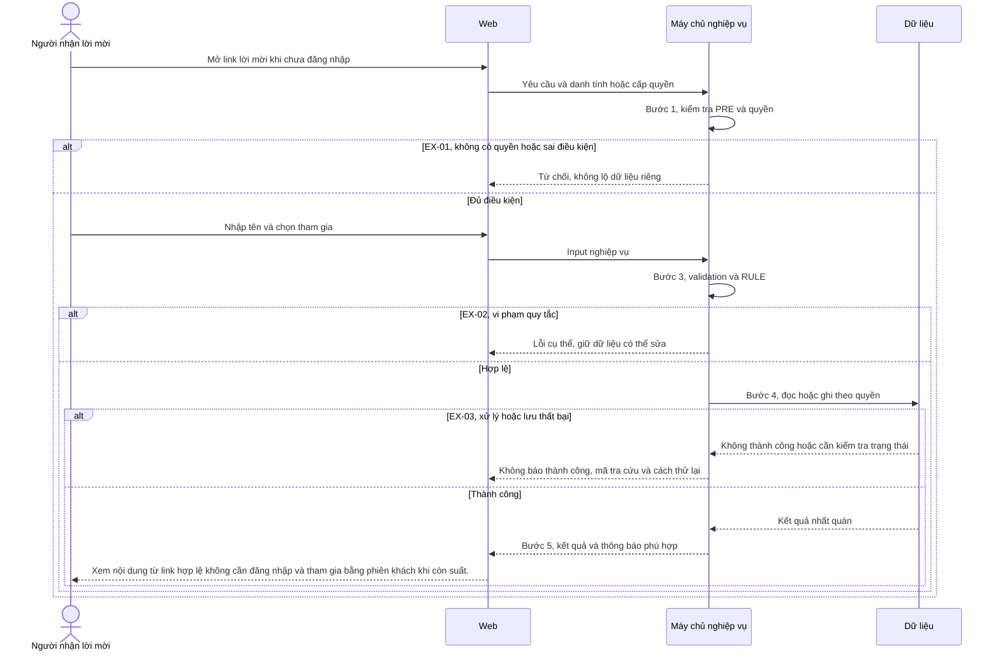
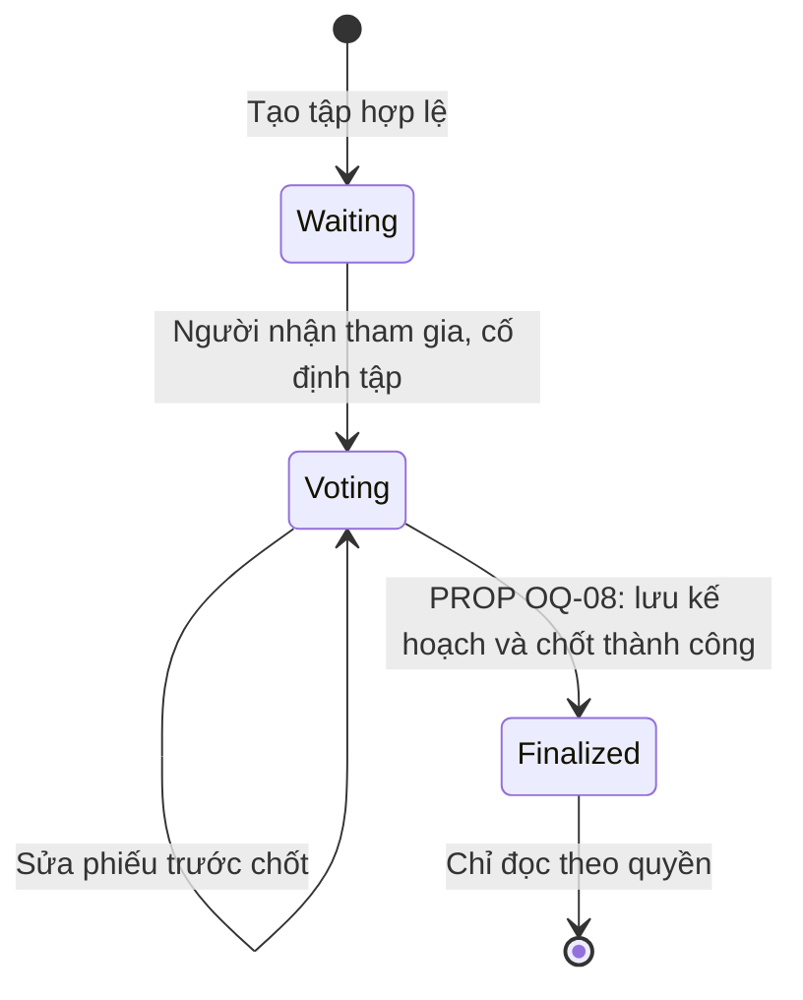

# UC-008: Tham gia phiên cùng chọn

**Version:** 1.1 — 15-11-2026  
**Status:** Draft, chờ duyệt nghiệp vụ; chưa tự coi các PROP/TBD là baseline.  
**Requirement chính:** [GWB-REQ-G1 v1.1](../requirements/GoWithBae_Requirements_G1_v1.1.md)  
**Nguồn khách hàng:** §5.2 + CR-001 ngày 15-11-2026  
**Truy vết:** FR-11, FR-22; AC-015, AC-016, AC-055, AC-056.

## 1. Overview

| Trường | Nội dung |
|---|---|
| Goal | Xem nội dung từ link hợp lệ không cần đăng nhập và tham gia bằng phiên khách khi còn suất. |
| Primary Actor | Người nhận lời mời |
| Secondary Actors | Máy chủ GoWithBae; dịch vụ email/bản đồ/tệp/lịch chỉ khi thao tác tương ứng cần tích hợp, theo requirement §7 |
| Trigger | Mở link lời mời khi chưa đăng nhập |
| Scope IN | Tham gia phiên cùng chọn trên web G1 theo các FR liên kết |
| Scope OUT | Chức năng G2, đặt chỗ/thanh toán/app/AI/chat; quyền và thao tác ngoài mục tiêu UC. Điều hướng sang UC khác không tự thực hiện UC đó. |

## 2. Preconditions

- PRE-1: Có link còn hiệu lực, chưa thu hồi; mở xem không cần tài khoản hoặc phiên đăng nhập. Enforce tại bước 1; kiểm tra lại quyền/trạng thái liên quan tại bước 3–4 trước khi trả dữ liệu hoặc ghi.
- PRE-2: Khi tham gia cùng chọn cần còn suất người nhận; chỉ xem không yêu cầu đăng nhập/đăng ký. Enforce tại bước 1; kiểm tra lại quyền/trạng thái liên quan tại bước 3–4 trước khi trả dữ liệu hoặc ghi.

## 3. Postconditions

- POST-1: Khách xem được nội dung theo link không cần tài khoản; tham gia thì tối đa một người nhận có phiên khách theo link, tập lựa chọn cố định; không có quyền cá nhân của chủ tạo. Được tạo tại bước 4 và phản hồi tại bước 5.
- POST-2: Quyền riêng tư/phạm vi được giữ; không thay dữ liệu ngoài mục tiêu hoặc thông báo thành công khi bước 4 thất bại. Enforce bước 1, 3–5 và EX-01–04.
- Nếu use case thất bại: không ghi kết quả nghiệp vụ dở dang như đã hoàn tất; dữ liệu đã lưu thành công không bị báo chưa lưu chỉ vì lỗi thông báo/analytics sau đó.

## 4. Main Flow

| Bước | Actor | Hành động | System Response |
|---|---|---|---|
| 1 | Người nhận lời mời | Mở link lời mời khi chưa đăng nhập | Kiểm tra grant/hạn/thu hồi và hiển thị nội dung được chia sẻ; không redirect sang màn đăng nhập, không đòi tài khoản. |
| 2 | Người nhận lời mời | Nhập tên và chọn tham gia | Nhận tên hiển thị mà không buộc đăng ký/đăng nhập hoặc khai quan hệ. |
| 3 | Người nhận lời mời | Gửi tham gia | Kiểm tra lại link và suất người nhận ở thời điểm ghi; nếu đồng thời chỉ một yêu cầu được chiếm suất. |
| 4 | Người nhận lời mời | Nhận phiên khách | Hệ thống tự giữ phiên khách theo link để nhớ người nhận/quyền, không tạo phiên đăng nhập tài khoản; cố định tập địa điểm, không cấp quyền sửa plan. |
| 5 | Người nhận lời mời | Xem các lựa chọn | Chỉ trả dữ liệu được mời, không toàn bộ danh sách/email/lịch sử người tạo. |

Các xử lý kiểm tra, truy vấn/ghi, chuyển trạng thái, thông báo và analytics trong cột System Response do hệ thống thực hiện, không do actor tự gán trạng thái/quyền.

## 5. Alternate Flows

**AF-01 — Hướng đi hợp lệ khác:** Tại bước 1, chỉ muốn xem → sau kiểm tra link hiển thị nội dung được phép và kết thúc, không buộc nhập tên/đăng nhập; tên dùng khi tham gia. Đã có phiên khách hợp lệ → xác minh grant rồi bước 5. Khách bấm Lưu yêu thích hoặc thao tác cá nhân → UC-004 trước UC cá nhân, không chặn xem link. Mất phiên không tự nhận lại bằng tên; chủ tạo cấp lại qua UC-011.

## 6. Exception Flows

**EX-01 — PRE/quyền không đạt.**
- Trigger: không đạt một trong PRE, danh tính/quyền/cấp quyền hết hiệu lực hoặc tài nguyên không được đọc.
- At step 1 hoặc kiểm tra lại bước 3–4: từ chối và không trả dữ liệu riêng; không chỉ ẩn nút phía client.
- Recovery: với thao tác tài khoản, đăng nhập lại khi cần; với khách nhận link, chỉ cần link/phiên khách hợp lệ, không bắt đăng nhập để xem. Xin mời lại/liên hệ người có quyền rồi bắt đầu bước 1; không lách bằng đổi id.

**EX-02 — Vi phạm đầu vào hoặc quy tắc nghiệp vụ.**
- Trigger: Link hết hạn/thu hồi, tên rỗng hoặc suất đã có người: không tham gia; link lỗi không lộ nội dung, suất đầy giải thích liên hệ chủ tạo. Hai yêu cầu đồng thời không tạo hai người nhận.
- At step 3; kiểm tra biên/trạng thái lại trước ghi tại bước 4. Không ghi kết quả sai; giải thích trường hoặc điều kiện không đạt.
- Recovery: sửa đầu vào ở bước 2, hoặc nạp trạng thái mới từ bước 1 rồi thử lại; OQ chặn phải được PO quyết định, không tự đặt mặc định.

**EX-03 — Đọc/ghi hoặc tích hợp phục vụ nghiệp vụ thất bại.**
- Trigger: timeout, dịch vụ cần thiết không đáp ứng, thao tác đồng thời làm dữ liệu thay đổi hoặc kết quả ghi chưa rõ.
- At step 4: không trả “thành công” khi chưa có kết quả chắc chắn; hiển thị mã tra cứu và giữ input an toàn có thể dùng lại.
- Recovery: kiểm tra trạng thái hiện tại trước retry thao tác ghi để không tạo lặp; đọc có thể thử lại; lỗi kéo dài chuyển vận hành tra mã. Với tích hợp có fallback cụ thể, dùng AF-01/requirement §7 thay vì tự bịa dữ liệu.

**EX-04 — Phản hồi/side effect sau thành công gặp lỗi.**
- Trigger: mất kết nối khi trả kết quả, lỗi thông báo/email/analytics cần thiết sau khi kết quả nghiệp vụ đã được xác lập.
- At step 5: giữ kết quả đã lưu, không báo sai thành thất bại nghiệp vụ và không lộ bí mật trong log.
- Recovery: tải lại/tra trạng thái; vận hành theo dõi và retry phần gửi/ghi sự kiện với mã chống trùng. Không tự tạo lại đối tượng nghiệp vụ chỉ để gửi lại thông báo.

## 7. Business Rules

Định nghĩa đầy đủ tại requirement chính §5. Quy tắc áp dụng vào bước và handler dưới đây; exception phải giữ đúng hậu điều kiện riêng của UC, không coi mọi lỗi đều rollback thao tác đã hoàn tất.

| Rule ID | Description và xử lý khi vi phạm | Applies At Step / handler |
|---|---|---|
| RULE-08 | Phiên cùng chọn lấy 2–5 địa điểm đã lưu; một người tạo + một người nhận Khi vi phạm: Sai số lượng chặn tạo; suất đã có người chặn tham gia khác; nơi ẩn OQ-11 | Bước 1/3–4; EX-01/EX-02/EX-03 |
| RULE-09 | Cố định tập địa điểm sau người nhận tham gia; muốn đổi tạo phiên mới Khi vi phạm: Chặn sửa tập đang dùng, giữ nghĩa phiếu; hướng dẫn tạo mới | Bước 1/3–4; EX-01/EX-02/EX-03 |
| RULE-12 | Link khó đoán, không index; hết hạn/thu hồi không cho truy cập; phiên khách riêng phụ thuộc cấp quyền còn hiệu lực Khi vi phạm: Báo link không hợp lệ; không lộ nội dung; chủ tạo mời lại. Hạn 7 ngày là đề xuất; OQ-07, OQ-09 | Bước 1/3–4; EX-01/EX-02/EX-03 |
| RULE-30 | [CONF] Xem link hợp lệ không cần tài khoản; phiên khách được cấp theo link, không phải đăng nhập. Dữ liệu/thao tác cá nhân cần tài khoản Khi vi phạm: Không redirect sang đăng nhập chỉ để xem link; link hết hạn/thu hồi vẫn chặn. Khách bấm lưu yêu thích được yêu cầu đăng nhập, không cấp quyền xem toàn bộ dữ liệu cá nhân người gửi | Bước 1/3–4; EX-01/EX-02/EX-03 |

## 8. Data Requirements

**Input và validation:**

- invite_token: bí mật link hợp lệ; không log công khai.
- display_name: tên hiển thị bắt buộc, không chỉ khoảng trắng; độ dài OQ-21.

**Output / state:** Khách xem được nội dung theo link không cần tài khoản; tham gia thì tối đa một người nhận có phiên khách theo link, tập lựa chọn cố định; không có quyền cá nhân của chủ tạo. Dữ liệu nghiệp vụ chi tiết tại requirement §6; giới hạn chưa có số phải theo OQ-21, không tự gán giá trị.

**Sequence diagram:** [file Mermaid](./UC-008-join-choice.mermaid).

**State machine:** [file Mermaid riêng](./UC-008-join-choice-state.mermaid). Trạng thái/transition PROP/TBD cần PO duyệt; trạng thái kết thúc có chủ ý không phải orphan.

## 9. Open Questions

OQ-07, OQ-09, OQ-21

Owner, mốc quyết định và mức chặn được ghi tại requirement §13. UC chỉ được baseline sau khi các câu hỏi ảnh hưởng tới nhánh triển khai đã được trả lời hoặc nhánh đó được PO loại khỏi phạm vi rõ ràng.

## 10. Notes và Acceptance Criteria

- Đây là đặc tả yêu cầu, chưa xây phần mềm; nội dung CR-001 mang nhãn CONF, phần PROP/TBD khác vẫn chưa được duyệt; không có bằng chứng kiểm thử runtime.
- Không chọn framework/API/token cụ thể; task tham chiếu hành vi và validation thay vì khóa giải pháp sớm.
- Source/DER/PROP/TBD tuân quy ước requirement chính; cần đọc OQ trước khi dùng làm input coding agent.

| Mã | Given | When | Then |
|---|---|---|---|
| AC-015 | Hai người khác nhau dùng link để tham gia cùng lúc | hai yêu cầu chiếm suất được xử lý | chỉ một người nhận thành công và tập lựa chọn không bị thay |
| AC-016 | Link đã thu hồi | mở hoặc gửi tham gia | bị chặn và không nhận nội dung phiên |
| AC-055 | Trình duyệt chưa đăng nhập và có link hợp lệ | mở link và tham gia bằng tên hiển thị | xem và tham gia bằng phiên khách, không bị đưa sang đăng nhập |
| AC-056 | Khách đang xem một nơi qua link hợp lệ | bấm Lưu yêu thích | yêu cầu đăng nhập cho thao tác cá nhân, quyền xem link không bị biến thành bắt buộc đăng nhập |

Ngoài các ví dụ Given/When/Then này, QA phải kiểm thử EX-01–04, các RULE áp dụng và boundary sau khi OQ đã được quyết định; danh sách này không thay thế toàn bộ kế hoạch kiểm thử. Các nội dung CR-001 đã CONF, chỉ chi tiết còn mở mới cần OQ.

## Verification Report — UC-008

### Blocking Issues / Open Questions cần unblock

OQ-07, OQ-09, OQ-21

Các OQ có mức chặn ở requirement §13 ảnh hưởng trực tiếp bước 3–4. Không kết luận “ready to code” khi chưa chốt chính sách liên quan.

### Warnings

- Giới hạn input, cấu hình dịch vụ/quyền/retention phải duyệt theo phạm vi; task chưa phải ước lượng ngày công hay giải pháp cuối.
- Sơ đồ diễn tả luồng chính và nhánh lỗi; chi tiết AF/EX bằng văn bản là một phần đặc tả bắt buộc.

### Passed — kiểm tra tài liệu, không phải test hệ thống

- Mỗi PRE có kiểm tra ở bước 1 và kiểm tra lại trước kết quả tại bước 3–4.
- POST-1 có xử lý ở bước 4–5; POST-2 được giữ bởi kiểm tra quyền và EX-01–04.
- RULE có bước áp dụng và handler; AF có điểm quay lại/kết thúc; EX có Recovery.
- Một primary actor và một mục tiêu; không có bước thực thi chức năng G2.
- Trạng thái có điều kiện vào/ra hoặc trạng thái kết thúc có chủ ý; PROP/TBD không được coi là chính sách đã duyệt.
