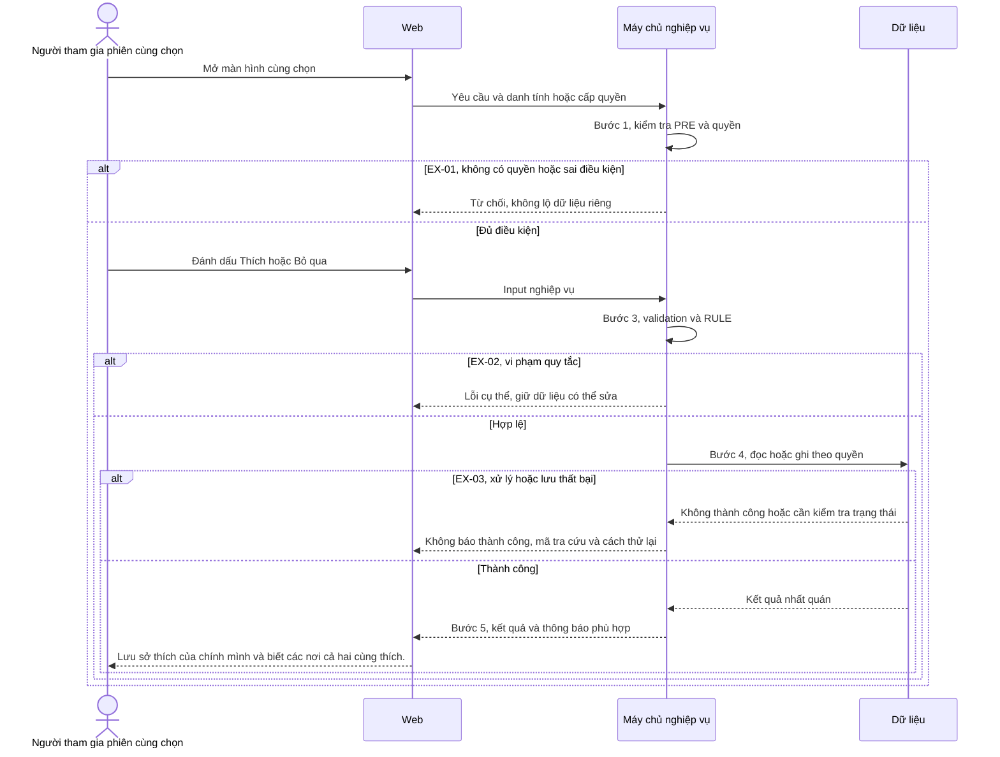
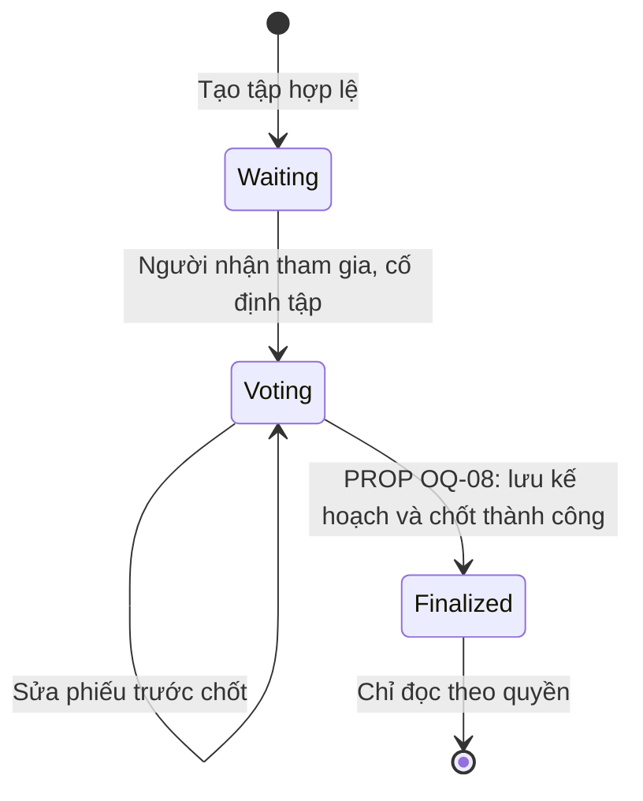

# UC-009: Bỏ phiếu và xem lựa chọn trùng

**Version:** 1.1 — 15-11-2026  
**Status:** Draft, chờ duyệt nghiệp vụ; chưa tự coi các PROP/TBD là baseline.  
**Requirement chính:** [GWB-REQ-G1 v1.1](../requirements/GoWithBae_Requirements_G1_v1.1.md)  
**Nguồn khách hàng:** §5.2  
**Truy vết:** FR-12, FR-22; AC-017, AC-018.

## 1. Overview

| Trường | Nội dung |
|---|---|
| Goal | Lưu sở thích của chính mình và biết các nơi cả hai cùng thích. |
| Primary Actor | Người tham gia phiên cùng chọn |
| Secondary Actors | Máy chủ GoWithBae; dịch vụ email/bản đồ/tệp/lịch chỉ khi thao tác tương ứng cần tích hợp, theo requirement §7 |
| Trigger | Mở màn hình cùng chọn |
| Scope IN | Bỏ phiếu và xem lựa chọn trùng trên web G1 theo các FR liên kết |
| Scope OUT | Chức năng G2, đặt chỗ/thanh toán/app/AI/chat; quyền và thao tác ngoài mục tiêu UC. Điều hướng sang UC khác không tự thực hiện UC đó. |

## 2. Preconditions

- PRE-1: Là người tạo có phiên tài khoản hợp lệ hoặc người nhận có grant/phiên khách còn quyền; người nhận không cần đăng nhập. Enforce tại bước 1; kiểm tra lại quyền/trạng thái liên quan tại bước 3–4 trước khi trả dữ liệu hoặc ghi.
- PRE-2: Phiên đang cho phép bỏ phiếu, chưa chốt; tập lựa chọn đã xác định. Enforce tại bước 1; kiểm tra lại quyền/trạng thái liên quan tại bước 3–4 trước khi trả dữ liệu hoặc ghi.

## 3. Postconditions

- POST-1: Phiếu đúng chủ/người/nơi được lưu, kết quả giao đúng và không tự quyết định địa điểm cuối. Được tạo tại bước 4 và phản hồi tại bước 5.
- POST-2: Quyền riêng tư/phạm vi được giữ; không thay dữ liệu ngoài mục tiêu hoặc thông báo thành công khi bước 4 thất bại. Enforce bước 1, 3–5 và EX-01–04.
- Nếu use case thất bại: không ghi kết quả nghiệp vụ dở dang như đã hoàn tất; dữ liệu đã lưu thành công không bị báo chưa lưu chỉ vì lỗi thông báo/analytics sau đó.

## 4. Main Flow

| Bước | Actor | Hành động | System Response |
|---|---|---|---|
| 1 | Người tham gia phiên cùng chọn | Mở màn hình cùng chọn | Kiểm tra tư cách người tham gia, grant, trạng thái và tập địa điểm. |
| 2 | Người tham gia phiên cùng chọn | Đánh dấu Thích hoặc Bỏ qua | Nhận lựa chọn cho từng nơi, gắn người tham gia từ danh tính truy cập. |
| 3 | Người tham gia phiên cùng chọn | Gửi hoặc sửa phiếu | Kiểm tra nơi thuộc tập, quyền của đúng người và phiên chưa chốt. |
| 4 | Người tham gia phiên cùng chọn | Lưu sở thích | Tạo/cập nhật phiếu của người đó; tính giao nơi cả hai cùng thích, chưa trả lời không phải bỏ qua. |
| 5 | Người tham gia phiên cùng chọn | Xem kết quả | Hiển thị nhóm trùng riêng, nơi còn lại vẫn xem được; ghi vote_submitted; không tự chốt. |

Các xử lý kiểm tra, truy vấn/ghi, chuyển trạng thái, thông báo và analytics trong cột System Response do hệ thống thực hiện, không do actor tự gán trạng thái/quyền.

## 5. Alternate Flows

**AF-01 — Hướng đi hợp lệ khác:** Tại bước 2, sửa lựa chọn trước chốt → bước 3–5 cập nhật giao. Không có giao ở bước 5 → gợi ý chọn lại từ bước 2 hoặc người tạo mở UC-007 với tập mới.

## 6. Exception Flows

**EX-01 — PRE/quyền không đạt.**
- Trigger: không đạt một trong PRE, danh tính/quyền/cấp quyền hết hiệu lực hoặc tài nguyên không được đọc.
- At step 1 hoặc kiểm tra lại bước 3–4: từ chối và không trả dữ liệu riêng; không chỉ ẩn nút phía client.
- Recovery: với thao tác tài khoản, đăng nhập lại khi cần; với khách nhận link, chỉ cần link/phiên khách hợp lệ, không bắt đăng nhập để xem. Xin mời lại/liên hệ người có quyền rồi bắt đầu bước 1; không lách bằng đổi id.

**EX-02 — Vi phạm đầu vào hoặc quy tắc nghiệp vụ.**
- Trigger: Giả id người kia, candidate ngoài tập, phiên chốt hoặc quyền bị thu hồi: không ghi phiếu; tải lại trạng thái và xin mời lại nếu cần. Tập sau join không được sửa trực tiếp.
- At step 3; kiểm tra biên/trạng thái lại trước ghi tại bước 4. Không ghi kết quả sai; giải thích trường hoặc điều kiện không đạt.
- Recovery: sửa đầu vào ở bước 2, hoặc nạp trạng thái mới từ bước 1 rồi thử lại; OQ chặn phải được PO quyết định, không tự đặt mặc định.

**EX-03 — Đọc/ghi hoặc tích hợp phục vụ nghiệp vụ thất bại.**
- Trigger: timeout, dịch vụ cần thiết không đáp ứng, thao tác đồng thời làm dữ liệu thay đổi hoặc kết quả ghi chưa rõ.
- At step 4: không trả “thành công” khi chưa có kết quả chắc chắn; hiển thị mã tra cứu và giữ input an toàn có thể dùng lại.
- Recovery: kiểm tra trạng thái hiện tại trước retry thao tác ghi để không tạo lặp; đọc có thể thử lại; lỗi kéo dài chuyển vận hành tra mã. Với tích hợp có fallback cụ thể, dùng AF-01/requirement §7 thay vì tự bịa dữ liệu.

**EX-04 — Phản hồi/side effect sau thành công gặp lỗi.**
- Trigger: mất kết nối khi trả kết quả, lỗi thông báo/email/analytics cần thiết sau khi kết quả nghiệp vụ đã được xác lập.
- At step 5: giữ kết quả đã lưu, không báo sai thành thất bại nghiệp vụ và không lộ bí mật trong log.
- Recovery: tải lại/tra trạng thái; vận hành theo dõi và retry phần gửi/ghi sự kiện với mã chống trùng. Không tự tạo lại đối tượng nghiệp vụ chỉ để gửi lại thông báo.

## 7. Business Rules

Định nghĩa đầy đủ tại requirement chính §5. Quy tắc áp dụng vào bước và handler dưới đây; exception phải giữ đúng hậu điều kiện riêng của UC, không coi mọi lỗi đều rollback thao tác đã hoàn tất.

| Rule ID | Description và xử lý khi vi phạm | Applies At Step / handler |
|---|---|---|
| RULE-09 | Cố định tập địa điểm sau người nhận tham gia; muốn đổi tạo phiên mới Khi vi phạm: Chặn sửa tập đang dùng, giữ nghĩa phiếu; hướng dẫn tạo mới | Bước 1/3–4; EX-01/EX-02/EX-03 |
| RULE-10 | Phiếu thuộc từng người/từng nơi, giá trị Thích/Bỏ qua/Chưa trả lời; chỉ sửa trước chốt Khi vi phạm: Sai người/nơi/trạng thái bị chặn; cả hai thích mới là giao; không có giao không tự chốt | Bước 1/3–4; EX-01/EX-02/EX-03 |
| RULE-11 | Chỉ người tạo chốt; hệ thống không tự chốt theo phiếu; chốt xong chỉ xem Khi vi phạm: Người nhận chốt/sửa phiếu sau chốt bị từ chối; lưu plan lỗi không được báo chốt thành công | Bước 1/3–4; EX-01/EX-02/EX-03 |
| RULE-12 | Link khó đoán, không index; hết hạn/thu hồi không cho truy cập; phiên khách riêng phụ thuộc cấp quyền còn hiệu lực Khi vi phạm: Báo link không hợp lệ; không lộ nội dung; chủ tạo mời lại. Hạn 7 ngày là đề xuất; OQ-07, OQ-09 | Bước 1/3–4; EX-01/EX-02/EX-03 |
| RULE-25 | Sự kiện có mã chống trùng; báo cáo tách khách/tài khoản, tự báo/đơn; không ghi dữ liệu nhạy cảm đã cấm Khi vi phạm: Loại sự kiện lặp khỏi tổng; không hợp nhất xuyên thiết bị khi chưa có căn cứ | Bước 3–5; EX-02/EX-03/EX-04 |
| RULE-30 | [CONF] Xem link hợp lệ không cần tài khoản; phiên khách được cấp theo link, không phải đăng nhập. Dữ liệu/thao tác cá nhân cần tài khoản Khi vi phạm: Không redirect sang đăng nhập chỉ để xem link; link hết hạn/thu hồi vẫn chặn. Khách bấm lưu yêu thích được yêu cầu đăng nhập, không cấp quyền xem toàn bộ dữ liệu cá nhân người gửi | Bước 1/3–4; EX-01/EX-02/EX-03 |

## 8. Data Requirements

**Input và validation:**

- choice_id/candidate_id: thuộc đúng phiên và tập cố định.
- preference: Thích hoặc Bỏ qua khi gửi; chưa gửi hiển thị Chưa trả lời.
- participant: lấy từ phiên máy chủ, không tin id người bỏ phiếu gửi lên.

**Output / state:** Phiếu đúng chủ/người/nơi được lưu, kết quả giao đúng và không tự quyết định địa điểm cuối. Dữ liệu nghiệp vụ chi tiết tại requirement §6; giới hạn chưa có số phải theo OQ-21, không tự gán giá trị.

**Sequence diagram:** [file Mermaid](./UC-009-vote-choice.mermaid).

**State machine:** [file Mermaid riêng](./UC-009-vote-choice-state.mermaid). Trạng thái/transition PROP/TBD cần PO duyệt; trạng thái kết thúc có chủ ý không phải orphan.

## 9. Open Questions

OQ-07, OQ-08, OQ-09

Owner, mốc quyết định và mức chặn được ghi tại requirement §13. UC chỉ được baseline sau khi các câu hỏi ảnh hưởng tới nhánh triển khai đã được trả lời hoặc nhánh đó được PO loại khỏi phạm vi rõ ràng.

## 10. Notes và Acceptance Criteria

- Đây là đặc tả yêu cầu, chưa xây phần mềm; nội dung CR-001 mang nhãn CONF, phần PROP/TBD khác vẫn chưa được duyệt; không có bằng chứng kiểm thử runtime.
- Không chọn framework/API/token cụ thể; task tham chiếu hành vi và validation thay vì khóa giải pháp sớm.
- Source/DER/PROP/TBD tuân quy ước requirement chính; cần đọc OQ trước khi dùng làm input coding agent.

| Mã | Given | When | Then |
|---|---|---|---|
| AC-017 | Cả hai Thích A, một người chưa trả lời B | xem kết quả | A nằm trong nhóm trùng, B không được xem là cả hai thích |
| AC-018 | Phiên đã chốt hoặc quyền bị thu hồi | gửi sửa phiếu | phiếu không thay đổi và nhận hướng dẫn trạng thái/quyền |

Ngoài các ví dụ Given/When/Then này, QA phải kiểm thử EX-01–04, các RULE áp dụng và boundary sau khi OQ đã được quyết định; danh sách này không thay thế toàn bộ kế hoạch kiểm thử. Các nội dung CR-001 đã CONF, chỉ chi tiết còn mở mới cần OQ.

## Verification Report — UC-009

### Blocking Issues / Open Questions cần unblock

OQ-07, OQ-08, OQ-09

Các OQ có mức chặn ở requirement §13 ảnh hưởng trực tiếp bước 3–4. Không kết luận “ready to code” khi chưa chốt chính sách liên quan.

### Warnings

- Giới hạn input, cấu hình dịch vụ/quyền/retention phải duyệt theo phạm vi; task chưa phải ước lượng ngày công hay giải pháp cuối.
- Sơ đồ diễn tả luồng chính và nhánh lỗi; chi tiết AF/EX bằng văn bản là một phần đặc tả bắt buộc.

### Passed — kiểm tra tài liệu, không phải test hệ thống

- Mỗi PRE có kiểm tra ở bước 1 và kiểm tra lại trước kết quả tại bước 3–4.
- POST-1 có xử lý ở bước 4–5; POST-2 được giữ bởi kiểm tra quyền và EX-01–04.
- RULE có bước áp dụng và handler; AF có điểm quay lại/kết thúc; EX có Recovery.
- Một primary actor và một mục tiêu; không có bước thực thi chức năng G2.
- Trạng thái có điều kiện vào/ra hoặc trạng thái kết thúc có chủ ý; PROP/TBD không được coi là chính sách đã duyệt.
