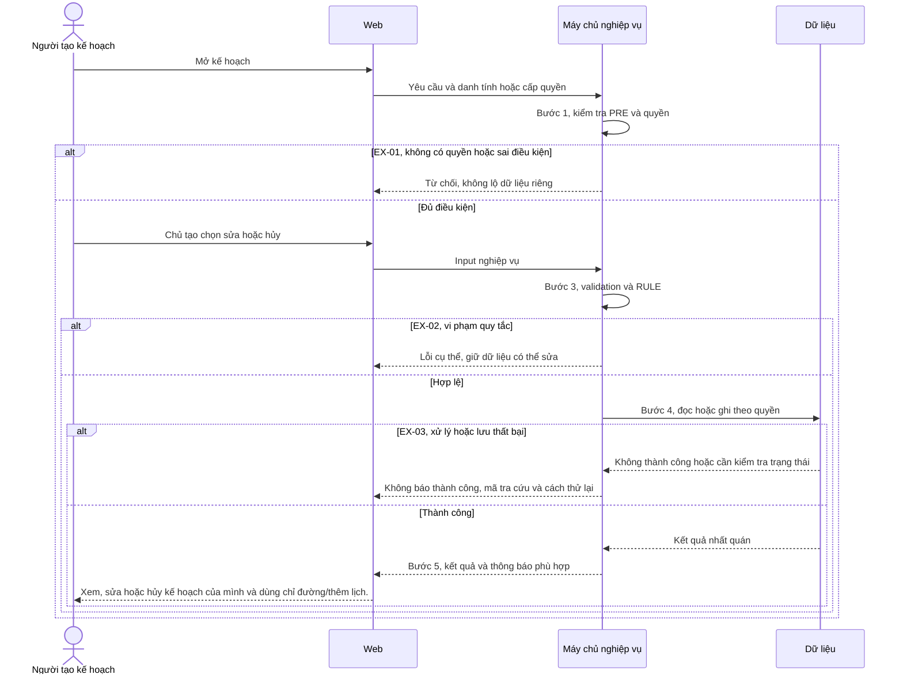
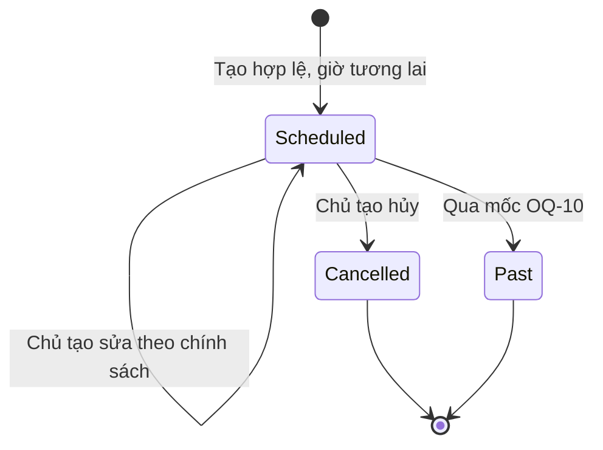

# UC-013: Xem và quản lý kế hoạch

**Version:** 1.1 — 15-11-2026  
**Status:** Draft, chờ duyệt nghiệp vụ; chưa tự coi các PROP/TBD là baseline.  
**Requirement chính:** [GWB-REQ-G1 v1.1](../requirements/GoWithBae_Requirements_G1_v1.1.md)  
**Nguồn khách hàng:** §5.3  
**Truy vết:** FR-16, FR-17, FR-22; AC-025, AC-026.

## 1. Overview

| Trường | Nội dung |
|---|---|
| Goal | Xem, sửa hoặc hủy kế hoạch của mình và dùng chỉ đường/thêm lịch. |
| Primary Actor | Người tạo kế hoạch |
| Secondary Actors | Máy chủ GoWithBae; người nhận kế hoạch chỉ xem; dịch vụ email/bản đồ/tệp/lịch chỉ khi thao tác tương ứng cần tích hợp, theo requirement §7 |
| Trigger | Mở kế hoạch |
| Scope IN | Xem và quản lý kế hoạch trên web G1 theo các FR liên kết |
| Scope OUT | Chức năng G2, đặt chỗ/thanh toán/app/AI/chat; quyền và thao tác ngoài mục tiêu UC. Điều hướng sang UC khác không tự thực hiện UC đó. |

## 2. Preconditions

- PRE-1: Có phiên chủ sở hữu; thao tác sửa/hủy phải phù hợp trạng thái đã duyệt. Enforce tại bước 1; kiểm tra lại quyền/trạng thái liên quan tại bước 3–4 trước khi trả dữ liệu hoặc ghi.
- PRE-2: Người nhận chỉ có quyền xem, được kiểm tra riêng theo grant; không phải actor sửa trong UC này. Enforce tại bước 1; kiểm tra lại quyền/trạng thái liên quan tại bước 3–4 trước khi trả dữ liệu hoặc ghi.

## 3. Postconditions

- POST-1: Plan phản ánh thay đổi của chủ và thời điểm cập nhật; người nhận chỉ thấy bản được phép; lịch ngoài chỉ được cập nhật theo cơ chế đã duyệt. Được tạo tại bước 4 và phản hồi tại bước 5.
- POST-2: Quyền riêng tư/phạm vi được giữ; không thay dữ liệu ngoài mục tiêu hoặc thông báo thành công khi bước 4 thất bại. Enforce bước 1, 3–5 và EX-01–04.
- Nếu use case thất bại: không ghi kết quả nghiệp vụ dở dang như đã hoàn tất; dữ liệu đã lưu thành công không bị báo chưa lưu chỉ vì lỗi thông báo/analytics sau đó.

## 4. Main Flow

| Bước | Actor | Hành động | System Response |
|---|---|---|---|
| 1 | Người tạo kế hoạch | Mở kế hoạch | Kiểm tra phiên, chủ sở hữu hoặc quyền chỉ xem của người nhận; ẩn hành động không được phép. |
| 2 | Người tạo kế hoạch | Chủ tạo chọn sửa hoặc hủy | Hiển thị dữ liệu hiện tại và người nhận liên quan; không cho người nhận sửa. |
| 3 | Người tạo kế hoạch | Gửi thay đổi | Kiểm tra lại quyền/trạng thái; đổi nơi như lúc tạo, thời gian và giờ mở cửa theo chính sách đã duyệt. |
| 4 | Người tạo kế hoạch | Lưu thay đổi | Cập nhật/hủy và updated_at; tạo thông báo cho tài khoản liên quan; không tạo đặt chỗ. |
| 5 | Người tạo kế hoạch | Xem bản mới hoặc mở chỉ đường/thêm lịch | Trả plan hiện tại; khách nhận link xem bản mới khi mở lại; lịch/chỉ đường lỗi không xóa plan. |

Các xử lý kiểm tra, truy vấn/ghi, chuyển trạng thái, thông báo và analytics trong cột System Response do hệ thống thực hiện, không do actor tự gán trạng thái/quyền.

## 5. Alternate Flows

**AF-01 — Hướng đi hợp lệ khác:** Tại bước 2, chỉ xem/chỉ đường/thêm lịch → không đổi plan, tới bước 5. Người nhận có grant hợp lệ theo bước 1 chỉ đọc ở bước 5, không đi vào bước sửa. Hủy theo bước 3–4 chỉ nếu trạng thái cho phép.

## 6. Exception Flows

**EX-01 — PRE/quyền không đạt.**
- Trigger: không đạt một trong PRE, danh tính/quyền/cấp quyền hết hiệu lực hoặc tài nguyên không được đọc.
- At step 1 hoặc kiểm tra lại bước 3–4: từ chối và không trả dữ liệu riêng; không chỉ ẩn nút phía client.
- Recovery: với thao tác tài khoản, đăng nhập lại khi cần; với khách nhận link, chỉ cần link/phiên khách hợp lệ, không bắt đăng nhập để xem. Xin mời lại/liên hệ người có quyền rồi bắt đầu bước 1; không lách bằng đổi id.

**EX-02 — Vi phạm đầu vào hoặc quy tắc nghiệp vụ.**
- Trigger: Người nhận/người ngoài sửa, nơi mới ẩn/đóng, thay id hoặc trạng thái không cho sửa: từ chối. Thông báo/email lỗi sau lưu không đảo ngược thay đổi; người dùng vẫn thấy trạng thái đã lưu và hệ thống theo dõi lỗi.
- At step 3; kiểm tra biên/trạng thái lại trước ghi tại bước 4. Không ghi kết quả sai; giải thích trường hoặc điều kiện không đạt.
- Recovery: sửa đầu vào ở bước 2, hoặc nạp trạng thái mới từ bước 1 rồi thử lại; OQ chặn phải được PO quyết định, không tự đặt mặc định.

**EX-03 — Đọc/ghi hoặc tích hợp phục vụ nghiệp vụ thất bại.**
- Trigger: timeout, dịch vụ cần thiết không đáp ứng, thao tác đồng thời làm dữ liệu thay đổi hoặc kết quả ghi chưa rõ.
- At step 4: không trả “thành công” khi chưa có kết quả chắc chắn; hiển thị mã tra cứu và giữ input an toàn có thể dùng lại.
- Recovery: kiểm tra trạng thái hiện tại trước retry thao tác ghi để không tạo lặp; đọc có thể thử lại; lỗi kéo dài chuyển vận hành tra mã. Với tích hợp có fallback cụ thể, dùng AF-01/requirement §7 thay vì tự bịa dữ liệu.

**EX-04 — Phản hồi/side effect sau thành công gặp lỗi.**
- Trigger: mất kết nối khi trả kết quả, lỗi thông báo/email/analytics cần thiết sau khi kết quả nghiệp vụ đã được xác lập.
- At step 5: giữ kết quả đã lưu, không báo sai thành thất bại nghiệp vụ và không lộ bí mật trong log.
- Recovery: tải lại/tra trạng thái; vận hành theo dõi và retry phần gửi/ghi sự kiện với mã chống trùng. Không tự tạo lại đối tượng nghiệp vụ chỉ để gửi lại thông báo.

## 7. Business Rules

Định nghĩa đầy đủ tại requirement chính §5. Quy tắc áp dụng vào bước và handler dưới đây; exception phải giữ đúng hậu điều kiện riêng của UC, không coi mọi lỗi đều rollback thao tác đã hoàn tất.

| Rule ID | Description và xử lý khi vi phạm | Applies At Step / handler |
|---|---|---|
| RULE-01 | Chỉ địa điểm đã duyệt và đang hiển thị được khám phá/tìm/chốt mới Khi vi phạm: Loại khỏi kết quả; chốt thất bại yêu cầu chọn lại; lịch sử giữ tên/cảnh báo theo quyền | Bước 1/3–4; EX-01/EX-02/EX-03 |
| RULE-05 | Lịch ngoại lệ phải được đối chiếu cùng lịch tuần; thời điểm kế hoạch tương lai; đã xác minh đóng cửa thì chặn tạo Khi vi phạm: Đổi giờ hoặc chọn nơi khác; chưa có giờ chỉ cảnh báo khi tạo nhưng không đạt lọc đang mở. [PROP] Ngoại lệ ưu tiên lịch tuần; ranh giới/qua đêm OQ-04 | Bước 1/3–4; EX-01/EX-02/EX-03 |
| RULE-13 | Kế hoạch có một địa điểm, chủ tạo, ngày giờ, ghi chú tùy chọn, người nhận nếu có Khi vi phạm: Thiếu/sai trường hoặc nơi không hợp lệ chặn lưu; không có đặt chỗ/thanh toán G1 | Bước 1/3–4; EX-01/EX-02/EX-03 |
| RULE-14 | Chủ tạo được sửa/hủy, người nhận chỉ xem; kiểm tra quyền tại máy chủ Khi vi phạm: Từ chối sửa/hủy của người khác; không chỉ ẩn nút. Chuyển kế hoạch đã qua giờ: OQ-10 | Bước 1/3–4; EX-01/EX-02/EX-03 |
| RULE-15 | Trạng thái plan, câu trả lời đã đi và trạng thái lời nhắc là ba dữ liệu riêng. Đến giờ hỏi “Đi chưa?”; Bỏ qua chỉ đóng nhắc Khi vi phạm: Không tự gán Không/Có khi bỏ qua, không đổi/hủy lịch hay gợi ý popup; không đổi plan hủy thành qua giờ; không gắn nhãn sử dụng đã xác minh | Bước 1/3–4; EX-01/EX-02/EX-03 |
| RULE-17 | Tài khoản khóa không tạo/sửa; xóa thu hồi phiên/link; hồ sơ không yêu cầu tình trạng quan hệ Khi vi phạm: Chặn thao tác không hợp lệ; chưa tuyên bố xóa dữ liệu hoàn tất khi mới nhận yêu cầu | Bước 1/3–4; EX-01/EX-02/EX-03 |
| RULE-24 | Thông báo đúng đối tượng, tiếp thị có lựa chọn riêng; chia sẻ không lộ dữ liệu ngoài phạm vi Khi vi phạm: Không gửi khi thiếu quyền; lỗi thông báo không được làm người dùng tưởng thao tác nghiệp vụ chưa được lưu | Bước 3–5; EX-02/EX-03/EX-04 |

## 8. Data Requirements

**Input và validation:**

- plan_id: thuộc chủ sở hữu; đọc người nhận theo quyền chia sẻ riêng.
- action: xem/sửa giờ, ghi chú, đổi nơi, hủy, chỉ đường hoặc thêm lịch.
- new_place_id/new_time/notes: kiểm tra lại như tạo khi đổi nơi, điều kiện sửa sau giờ OQ-10.
- calendar_mode: theo OQ-12, không mặc định sync hai chiều.

**Output / state:** Plan phản ánh thay đổi của chủ và thời điểm cập nhật; người nhận chỉ thấy bản được phép; lịch ngoài chỉ được cập nhật theo cơ chế đã duyệt. Dữ liệu nghiệp vụ chi tiết tại requirement §6; giới hạn chưa có số phải theo OQ-21, không tự gán giá trị.

**Sequence diagram:** [file Mermaid](./UC-013-manage-date-plan.mermaid).

**State machine:** [file Mermaid riêng](./UC-013-manage-date-plan-state.mermaid). Trạng thái/transition PROP/TBD cần PO duyệt; trạng thái kết thúc có chủ ý không phải orphan.

## 9. Open Questions

OQ-09, OQ-10, OQ-11, OQ-12

Owner, mốc quyết định và mức chặn được ghi tại requirement §13. UC chỉ được baseline sau khi các câu hỏi ảnh hưởng tới nhánh triển khai đã được trả lời hoặc nhánh đó được PO loại khỏi phạm vi rõ ràng.

## 10. Notes và Acceptance Criteria

- Đây là đặc tả yêu cầu, chưa xây phần mềm; nội dung CR-001 mang nhãn CONF, phần PROP/TBD khác vẫn chưa được duyệt; không có bằng chứng kiểm thử runtime.
- Không chọn framework/API/token cụ thể; task tham chiếu hành vi và validation thay vì khóa giải pháp sớm.
- Source/DER/PROP/TBD tuân quy ước requirement chính; cần đọc OQ trước khi dùng làm input coding agent.

| Mã | Given | When | Then |
|---|---|---|---|
| AC-025 | Người nhận có quyền xem plan | gọi trực tiếp thao tác sửa/hủy | bị từ chối và plan giữ nguyên |
| AC-026 | Chủ tạo đổi nơi sang nơi đã ẩn | lưu thay đổi | bị chặn, không thay thế địa điểm hiện tại |

Ngoài các ví dụ Given/When/Then này, QA phải kiểm thử EX-01–04, các RULE áp dụng và boundary sau khi OQ đã được quyết định; danh sách này không thay thế toàn bộ kế hoạch kiểm thử. Các nội dung CR-001 đã CONF, chỉ chi tiết còn mở mới cần OQ.

## Verification Report — UC-013

### Blocking Issues / Open Questions cần unblock

OQ-09, OQ-10, OQ-11, OQ-12

Các OQ có mức chặn ở requirement §13 ảnh hưởng trực tiếp bước 3–4. Không kết luận “ready to code” khi chưa chốt chính sách liên quan.

### Warnings

- Giới hạn input, cấu hình dịch vụ/quyền/retention phải duyệt theo phạm vi; task chưa phải ước lượng ngày công hay giải pháp cuối.
- Sơ đồ diễn tả luồng chính và nhánh lỗi; chi tiết AF/EX bằng văn bản là một phần đặc tả bắt buộc.

### Passed — kiểm tra tài liệu, không phải test hệ thống

- Mỗi PRE có kiểm tra ở bước 1 và kiểm tra lại trước kết quả tại bước 3–4.
- POST-1 có xử lý ở bước 4–5; POST-2 được giữ bởi kiểm tra quyền và EX-01–04.
- RULE có bước áp dụng và handler; AF có điểm quay lại/kết thúc; EX có Recovery.
- Một primary actor và một mục tiêu; không có bước thực thi chức năng G2.
- Trạng thái có điều kiện vào/ra hoặc trạng thái kết thúc có chủ ý; PROP/TBD không được coi là chính sách đã duyệt.
