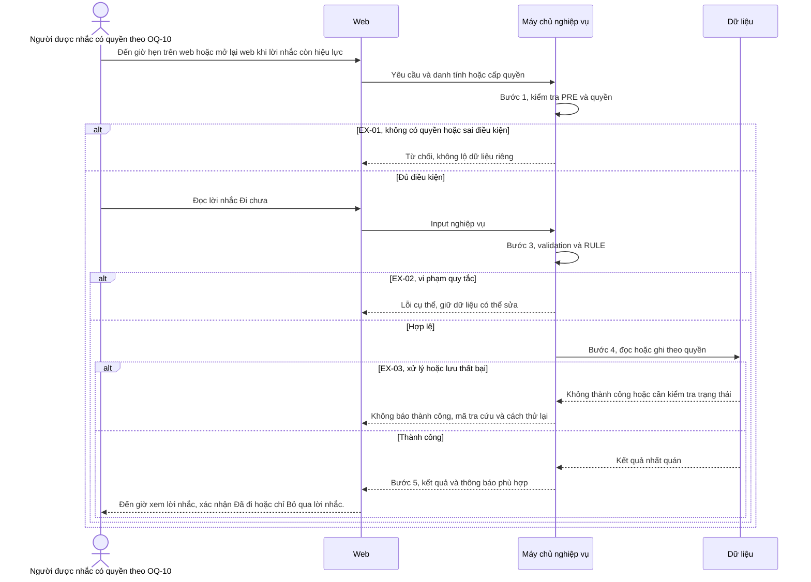
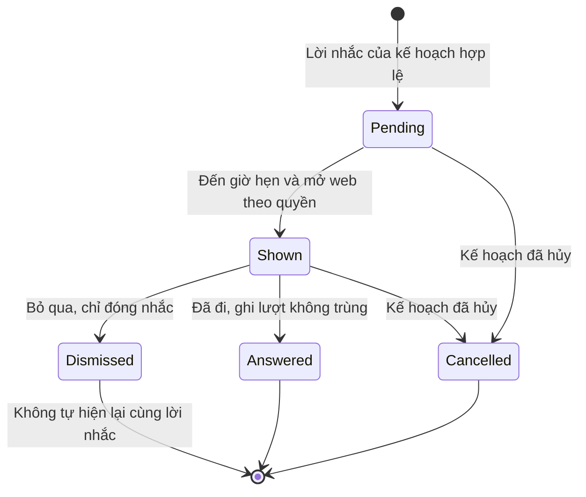

# UC-014: Xử lý lời nhắc Đi chưa và xác nhận đã đi

**Version:** 1.1 — 15-11-2026  
**Status:** Draft, chờ duyệt nghiệp vụ; chưa tự coi các PROP/TBD là baseline.  
**Requirement chính:** [GWB-REQ-G1 v1.1](../requirements/GoWithBae_Requirements_G1_v1.1.md)  
**Nguồn khách hàng:** §5.3, §10 + CR-001 ngày 15-11-2026  
**Truy vết:** FR-18, FR-35; AC-027, AC-028, AC-057, AC-058.

## 1. Overview

| Trường | Nội dung |
|---|---|
| Goal | Đến giờ xem lời nhắc, xác nhận Đã đi hoặc chỉ Bỏ qua lời nhắc. |
| Primary Actor | Người được nhắc có quyền theo OQ-10 |
| Secondary Actors | Máy chủ GoWithBae; dịch vụ email/bản đồ/tệp/lịch chỉ khi thao tác tương ứng cần tích hợp, theo requirement §7 |
| Trigger | Đến giờ hẹn trên web hoặc mở lại web khi lời nhắc còn hiệu lực |
| Scope IN | Xử lý lời nhắc Đi chưa và xác nhận đã đi trên web G1 theo các FR liên kết |
| Scope OUT | Chức năng G2, đặt chỗ/thanh toán/app/AI/chat; quyền và thao tác ngoài mục tiêu UC. Điều hướng sang UC khác không tự thực hiện UC đó. |

## 2. Preconditions

- PRE-1: Đã đến ngày giờ hẹn, kế hoạch chưa hủy, lời nhắc của người này chưa bị đóng hoặc trả lời. Enforce tại bước 1; kiểm tra lại quyền/trạng thái liên quan tại bước 3–4 trước khi trả dữ liệu hoặc ghi.
- PRE-2: Actor có quyền theo OQ-10; không mặc định khách nhận link được ghi lượt cá nhân khi chưa đăng nhập. Enforce tại bước 1; kiểm tra lại quyền/trạng thái liên quan tại bước 3–4 trước khi trả dữ liệu hoặc ghi.

## 3. Postconditions

- POST-1: Lời nhắc đóng đúng thao tác; Đã đi ghi một lượt hợp lệ, Bỏ qua chỉ lưu trạng thái đóng nhắc; không gợi ý quán/lịch mới, không suy ra Chưa đi, không tự đổi kế hoạch. Được tạo tại bước 4 và phản hồi tại bước 5.
- POST-2: Quyền riêng tư/phạm vi được giữ; không thay dữ liệu ngoài mục tiêu hoặc thông báo thành công khi bước 4 thất bại. Enforce bước 1, 3–5 và EX-01–04.
- Nếu use case thất bại: không ghi kết quả nghiệp vụ dở dang như đã hoàn tất; dữ liệu đã lưu thành công không bị báo chưa lưu chỉ vì lỗi thông báo/analytics sau đó.

## 4. Main Flow

| Bước | Actor | Hành động | System Response |
|---|---|---|---|
| 1 | Người được nhắc có quyền theo OQ-10 | Đến giờ hẹn trên web hoặc mở lại web khi lời nhắc còn hiệu lực | Kiểm tra quyền, scheduled_at, kế hoạch chưa hủy và lời nhắc chưa dismiss/answered; không phụ thuộc chờ trạng thái plan thành Past. |
| 2 | Người được nhắc có quyền theo OQ-10 | Đọc lời nhắc Đi chưa | Hiển thị Đã đi và Bỏ qua lời nhắc; không tự gán đã đi hoặc đề xuất quán/lịch khác. |
| 3 | Người được nhắc có quyền theo OQ-10 | Chọn Đã đi | Kiểm tra quyền xác nhận, dữ liệu kế hoạch và trạng thái hiện thời; lấy danh tính từ máy chủ. |
| 4 | Người được nhắc có quyền theo OQ-10 | Gửi xác nhận | Ghi VisitSelfReport=Có một lần cho lượt hợp lệ, đóng nhắc answered; cập nhật số lần theo RULE-29; không tạo chứng nhận sử dụng G2. |
| 5 | Người được nhắc có quyền theo OQ-10 | Xem kết quả | Đóng lời nhắc, hiển thị số lần hiện tại đúng tài khoản; ghi visit_self_reported chống trùng, không popup gợi ý khác. |

Các xử lý kiểm tra, truy vấn/ghi, chuyển trạng thái, thông báo và analytics trong cột System Response do hệ thống thực hiện, không do actor tự gán trạng thái/quyền.

## 5. Alternate Flows

**AF-01 — Hướng đi hợp lệ khác:** AF-01a tại bước 2: bấm Bỏ qua lời nhắc → kiểm tra quyền/trạng thái như bước 3, lưu dismissed/dismissed_at ở bước 4 rồi đóng nhắc và kết thúc bước 5; không đổi visit_answer/plan/ngày giờ/địa điểm/count, không popup khác. AF-01b: tải lại sau dismiss/answered → bước 1 đọc trạng thái đã lưu, không hiện lại cùng lời nhắc và kết thúc. AF-01c: chưa bấm gì → giữ Chưa trả lời; không tự ghi Có/Không.

## 6. Exception Flows

**EX-01 — PRE/quyền không đạt.**
- Trigger: không đạt một trong PRE, danh tính/quyền/cấp quyền hết hiệu lực hoặc tài nguyên không được đọc.
- At step 1 hoặc kiểm tra lại bước 3–4: từ chối và không trả dữ liệu riêng; không chỉ ẩn nút phía client.
- Recovery: với thao tác tài khoản, đăng nhập lại khi cần; với khách nhận link, chỉ cần link/phiên khách hợp lệ, không bắt đăng nhập để xem. Xin mời lại/liên hệ người có quyền rồi bắt đầu bước 1; không lách bằng đổi id.

**EX-02 — Vi phạm đầu vào hoặc quy tắc nghiệp vụ.**
- Trigger: Plan chưa tới giờ/đã hủy, actor không có quyền, action sai hoặc lời nhắc đã đóng: không tạo lượt mới. Retry Đã đi không tăng count lần nữa; retry dismiss không tạo nhắc mới. Không chuyển plan hủy thành Past. Lỗi lưu dismiss không báo đã ghi thành công, có thể thử lại an toàn.
- At step 3; kiểm tra biên/trạng thái lại trước ghi tại bước 4. Không ghi kết quả sai; giải thích trường hoặc điều kiện không đạt.
- Recovery: sửa đầu vào ở bước 2, hoặc nạp trạng thái mới từ bước 1 rồi thử lại; OQ chặn phải được PO quyết định, không tự đặt mặc định.

**EX-03 — Đọc/ghi hoặc tích hợp phục vụ nghiệp vụ thất bại.**
- Trigger: timeout, dịch vụ cần thiết không đáp ứng, thao tác đồng thời làm dữ liệu thay đổi hoặc kết quả ghi chưa rõ.
- At step 4: không trả “thành công” khi chưa có kết quả chắc chắn; hiển thị mã tra cứu và giữ input an toàn có thể dùng lại.
- Recovery: kiểm tra trạng thái hiện tại trước retry thao tác ghi để không tạo lặp; đọc có thể thử lại; lỗi kéo dài chuyển vận hành tra mã. Với tích hợp có fallback cụ thể, dùng AF-01/requirement §7 thay vì tự bịa dữ liệu.

**EX-04 — Phản hồi/side effect sau thành công gặp lỗi.**
- Trigger: mất kết nối khi trả kết quả, lỗi thông báo/email/analytics cần thiết sau khi kết quả nghiệp vụ đã được xác lập.
- At step 5: giữ kết quả đã lưu, không báo sai thành thất bại nghiệp vụ và không lộ bí mật trong log.
- Recovery: tải lại/tra trạng thái; vận hành theo dõi và retry phần gửi/ghi sự kiện với mã chống trùng. Không tự tạo lại đối tượng nghiệp vụ chỉ để gửi lại thông báo.

## 7. Business Rules

Định nghĩa đầy đủ tại requirement chính §5. Quy tắc áp dụng vào bước và handler dưới đây; exception phải giữ đúng hậu điều kiện riêng của UC, không coi mọi lỗi đều rollback thao tác đã hoàn tất.

| Rule ID | Description và xử lý khi vi phạm | Applies At Step / handler |
|---|---|---|
| RULE-14 | Chủ tạo được sửa/hủy, người nhận chỉ xem; kiểm tra quyền tại máy chủ Khi vi phạm: Từ chối sửa/hủy của người khác; không chỉ ẩn nút. Chuyển kế hoạch đã qua giờ: OQ-10 | Bước 1/3–4; EX-01/EX-02/EX-03 |
| RULE-15 | Trạng thái plan, câu trả lời đã đi và trạng thái lời nhắc là ba dữ liệu riêng. Đến giờ hỏi “Đi chưa?”; Bỏ qua chỉ đóng nhắc Khi vi phạm: Không tự gán Không/Có khi bỏ qua, không đổi/hủy lịch hay gợi ý popup; không đổi plan hủy thành qua giờ; không gắn nhãn sử dụng đã xác minh | Bước 1/3–4; EX-01/EX-02/EX-03 |
| RULE-25 | Sự kiện có mã chống trùng; báo cáo tách khách/tài khoản, tự báo/đơn; không ghi dữ liệu nhạy cảm đã cấm Khi vi phạm: Loại sự kiện lặp khỏi tổng; không hợp nhất xuyên thiết bị khi chưa có căn cứ | Bước 3–5; EX-02/EX-03/EX-04 |
| RULE-29 | [CONF] Số lần đã đi tăng từ lượt tự xác nhận Đã đi; [DER] đếm theo tài khoản + chi nhánh, một kế hoạch được xác nhận hợp lệ tối đa một lượt, retry không tăng Khi vi phạm: Không đếm theo số lần bấm/nhắc/tạo kế hoạch; Bỏ qua/Chưa trả lời/Không không tăng; dữ liệu bị thay đổi cần tính lại theo OQ-10/25, không tự dùng chuỗi thời gian liên tiếp | Bước 1/3–4; EX-01/EX-02/EX-03 |

## 8. Data Requirements

**Input và validation:**

- plan_id: kế hoạch có quyền xem và được nhắc; kiểm tra thời điểm hẹn, trạng thái hiện tại.
- reminder_action: Đã đi hoặc Bỏ qua lời nhắc; không dùng Bỏ qua làm câu trả lời Không.
- reminder_status: shown/answered/dismissed, thời điểm xử lý; lưu tách visit_answer.
- visit_answer: Có khi xác nhận Đã đi; nếu bỏ qua giữ nguyên, chưa trả lời vẫn Chưa trả lời; sửa câu trả lời theo OQ-10/25.

**Output / state:** Lời nhắc đóng đúng thao tác; Đã đi ghi một lượt hợp lệ, Bỏ qua chỉ lưu trạng thái đóng nhắc; không gợi ý quán/lịch mới, không suy ra Chưa đi, không tự đổi kế hoạch. Dữ liệu nghiệp vụ chi tiết tại requirement §6; giới hạn chưa có số phải theo OQ-21, không tự gán giá trị.

**Sequence diagram:** [file Mermaid](./UC-014-report-visit.mermaid).

**State machine:** [file Mermaid riêng](./UC-014-report-visit-state.mermaid). Trạng thái/transition PROP/TBD cần PO duyệt; trạng thái kết thúc có chủ ý không phải orphan.

## 9. Open Questions

OQ-10, OQ-25

Owner, mốc quyết định và mức chặn được ghi tại requirement §13. UC chỉ được baseline sau khi các câu hỏi ảnh hưởng tới nhánh triển khai đã được trả lời hoặc nhánh đó được PO loại khỏi phạm vi rõ ràng.

## 10. Notes và Acceptance Criteria

- Đây là đặc tả yêu cầu, chưa xây phần mềm; nội dung CR-001 mang nhãn CONF, phần PROP/TBD khác vẫn chưa được duyệt; không có bằng chứng kiểm thử runtime.
- Không chọn framework/API/token cụ thể; task tham chiếu hành vi và validation thay vì khóa giải pháp sớm.
- Source/DER/PROP/TBD tuân quy ước requirement chính; cần đọc OQ trước khi dùng làm input coding agent.

| Mã | Given | When | Then |
|---|---|---|---|
| AC-027 | Plan đã đến giờ nhưng người dùng chưa trả lời | chỉ xem lời nhắc | visit_answer vẫn Chưa trả lời và count không tăng |
| AC-028 | Plan đã hủy trước giờ | tác vụ thời gian chạy sau giờ hẹn | plan vẫn Đã hủy, không hiện nhắc và không tự xác nhận đã đến/đã qua giờ |
| AC-057 | Kế hoạch chưa hủy đã đến scheduled_at, lời nhắc còn hiệu lực và người có quyền đang mở web | đến thời điểm nhắc | hiển thị Đi chưa tại giờ hẹn, không đợi quyết định mốc Past của plan |
| AC-058 | Lời nhắc Đi chưa đang hiện và câu trả lời là Chưa trả lời | bấm Bỏ qua lời nhắc rồi tải lại trang | lời nhắc biến mất và không tự hiện lại; không popup khác, không đổi lịch/địa điểm/visit_answer/count |

Ngoài các ví dụ Given/When/Then này, QA phải kiểm thử EX-01–04, các RULE áp dụng và boundary sau khi OQ đã được quyết định; danh sách này không thay thế toàn bộ kế hoạch kiểm thử. Các nội dung CR-001 đã CONF, chỉ chi tiết còn mở mới cần OQ.

## Verification Report — UC-014

### Blocking Issues / Open Questions cần unblock

OQ-10, OQ-25

Các OQ có mức chặn ở requirement §13 ảnh hưởng trực tiếp bước 3–4. Không kết luận “ready to code” khi chưa chốt chính sách liên quan.

### Warnings

- Giới hạn input, cấu hình dịch vụ/quyền/retention phải duyệt theo phạm vi; task chưa phải ước lượng ngày công hay giải pháp cuối.
- Sơ đồ diễn tả luồng chính và nhánh lỗi; chi tiết AF/EX bằng văn bản là một phần đặc tả bắt buộc.

### Passed — kiểm tra tài liệu, không phải test hệ thống

- Mỗi PRE có kiểm tra ở bước 1 và kiểm tra lại trước kết quả tại bước 3–4.
- POST-1 có xử lý ở bước 4–5; POST-2 được giữ bởi kiểm tra quyền và EX-01–04.
- RULE có bước áp dụng và handler; AF có điểm quay lại/kết thúc; EX có Recovery.
- Một primary actor và một mục tiêu; không có bước thực thi chức năng G2.
- Trạng thái có điều kiện vào/ra hoặc trạng thái kết thúc có chủ ý; PROP/TBD không được coi là chính sách đã duyệt.
