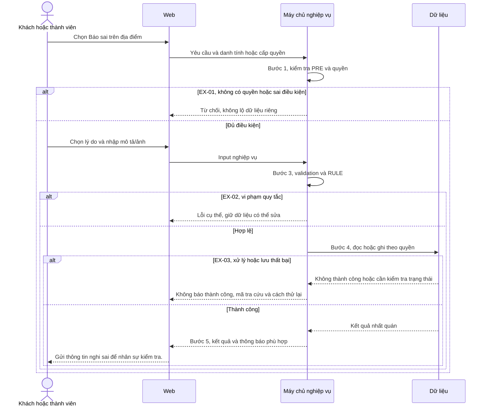

# UC-015: Báo thông tin địa điểm sai

**Version:** 1.1 — 15-11-2026  
**Status:** Draft, chờ duyệt nghiệp vụ; chưa tự coi các PROP/TBD là baseline.  
**Requirement chính:** [GWB-REQ-G1 v1.1](../requirements/GoWithBae_Requirements_G1_v1.1.md)  
**Nguồn khách hàng:** §6.2/F09  
**Truy vết:** FR-19; AC-029, AC-030.

## 1. Overview

| Trường | Nội dung |
|---|---|
| Goal | Gửi thông tin nghi sai để nhân sự kiểm tra. |
| Primary Actor | Khách hoặc thành viên |
| Secondary Actors | Máy chủ GoWithBae; dịch vụ email/bản đồ/tệp/lịch chỉ khi thao tác tương ứng cần tích hợp, theo requirement §7 |
| Trigger | Chọn Báo sai trên địa điểm |
| Scope IN | Báo thông tin địa điểm sai trên web G1 theo các FR liên kết |
| Scope OUT | Chức năng G2, đặt chỗ/thanh toán/app/AI/chat; quyền và thao tác ngoài mục tiêu UC. Điều hướng sang UC khác không tự thực hiện UC đó. |

## 2. Preconditions

- PRE-1: Có mã địa điểm trong ngữ cảnh được phép báo sai. Enforce tại bước 1; kiểm tra lại quyền/trạng thái liên quan tại bước 3–4 trước khi trả dữ liệu hoặc ghi.
- PRE-2: Khách không buộc đăng nhập nhưng phải tuân giới hạn chống lạm dụng. Enforce tại bước 1; kiểm tra lại quyền/trạng thái liên quan tại bước 3–4 trước khi trả dữ liệu hoặc ghi.

## 3. Postconditions

- POST-1: Báo sai mới có mã và được đưa vào hàng chờ; hồ sơ địa điểm chưa tự thay đổi. Được tạo tại bước 4 và phản hồi tại bước 5.
- POST-2: Quyền riêng tư/phạm vi được giữ; không thay dữ liệu ngoài mục tiêu hoặc thông báo thành công khi bước 4 thất bại. Enforce bước 1, 3–5 và EX-01–04.
- Nếu use case thất bại: không ghi kết quả nghiệp vụ dở dang như đã hoàn tất; dữ liệu đã lưu thành công không bị báo chưa lưu chỉ vì lỗi thông báo/analytics sau đó.

## 4. Main Flow

| Bước | Actor | Hành động | System Response |
|---|---|---|---|
| 1 | Khách hoặc thành viên | Chọn Báo sai trên địa điểm | Kiểm tra mã nơi và giới hạn gửi, lấy người gửi nếu đã đăng nhập. |
| 2 | Khách hoặc thành viên | Chọn lý do và nhập mô tả/ảnh | Nhận nội dung; không bắt buộc đăng ký. |
| 3 | Khách hoặc thành viên | Gửi báo sai | Kiểm tra reason, trường nội dung và ảnh theo hạn mức/validation đã chốt. |
| 4 | Khách hoặc thành viên | Lưu báo sai | Tạo mã, gắn địa điểm/người gửi nếu có/thời gian, trạng thái Mới; không sửa hồ sơ công khai. |
| 5 | Khách hoặc thành viên | Nhận xác nhận | Trả mã báo sai và hướng dẫn phù hợp; không công khai nội dung/người gửi cho khách khác. |

Các xử lý kiểm tra, truy vấn/ghi, chuyển trạng thái, thông báo và analytics trong cột System Response do hệ thống thực hiện, không do actor tự gán trạng thái/quyền.

## 5. Alternate Flows

**AF-01 — Hướng đi hợp lệ khác:** Tại bước 2, không có ảnh minh chứng → bỏ qua ảnh, tiếp tục bước 3; nội dung không vì thiếu ảnh mà tự bị kết luận sai.

## 6. Exception Flows

**EX-01 — PRE/quyền không đạt.**
- Trigger: không đạt một trong PRE, danh tính/quyền/cấp quyền hết hiệu lực hoặc tài nguyên không được đọc.
- At step 1 hoặc kiểm tra lại bước 3–4: từ chối và không trả dữ liệu riêng; không chỉ ẩn nút phía client.
- Recovery: với thao tác tài khoản, đăng nhập lại khi cần; với khách nhận link, chỉ cần link/phiên khách hợp lệ, không bắt đăng nhập để xem. Xin mời lại/liên hệ người có quyền rồi bắt đầu bước 1; không lách bằng đổi id.

**EX-02 — Vi phạm đầu vào hoặc quy tắc nghiệp vụ.**
- Trigger: Reason sai, ảnh không hợp lệ hoặc gửi vượt giới hạn: chặn phần không hợp lệ, hướng dẫn sửa/chờ. Đóng báo sai sau này cần ghi chú qua UC-024.
- At step 3; kiểm tra biên/trạng thái lại trước ghi tại bước 4. Không ghi kết quả sai; giải thích trường hoặc điều kiện không đạt.
- Recovery: sửa đầu vào ở bước 2, hoặc nạp trạng thái mới từ bước 1 rồi thử lại; OQ chặn phải được PO quyết định, không tự đặt mặc định.

**EX-03 — Đọc/ghi hoặc tích hợp phục vụ nghiệp vụ thất bại.**
- Trigger: timeout, dịch vụ cần thiết không đáp ứng, thao tác đồng thời làm dữ liệu thay đổi hoặc kết quả ghi chưa rõ.
- At step 4: không trả “thành công” khi chưa có kết quả chắc chắn; hiển thị mã tra cứu và giữ input an toàn có thể dùng lại.
- Recovery: kiểm tra trạng thái hiện tại trước retry thao tác ghi để không tạo lặp; đọc có thể thử lại; lỗi kéo dài chuyển vận hành tra mã. Với tích hợp có fallback cụ thể, dùng AF-01/requirement §7 thay vì tự bịa dữ liệu.

**EX-04 — Phản hồi/side effect sau thành công gặp lỗi.**
- Trigger: mất kết nối khi trả kết quả, lỗi thông báo/email/analytics cần thiết sau khi kết quả nghiệp vụ đã được xác lập.
- At step 5: giữ kết quả đã lưu, không báo sai thành thất bại nghiệp vụ và không lộ bí mật trong log.
- Recovery: tải lại/tra trạng thái; vận hành theo dõi và retry phần gửi/ghi sự kiện với mã chống trùng. Không tự tạo lại đối tượng nghiệp vụ chỉ để gửi lại thông báo.

## 7. Business Rules

Định nghĩa đầy đủ tại requirement chính §5. Quy tắc áp dụng vào bước và handler dưới đây; exception phải giữ đúng hậu điều kiện riêng của UC, không coi mọi lỗi đều rollback thao tác đã hoàn tất.

| Rule ID | Description và xử lý khi vi phạm | Applies At Step / handler |
|---|---|---|
| RULE-18 | Báo sai được gửi ẩn danh có chống lạm dụng; không sửa công khai tự động; đóng có ghi chú Khi vi phạm: Quá hạn mức chặn và cho biết cách thử lại; thiếu ghi chú chặn đóng; mở lại theo quyền | Bước 1/3–4; EX-01/EX-02/EX-03 |
| RULE-27 | Tệp giới hạn định dạng/kích thước, kiểm tra nội dung; không công khai token/khóa; nhân viên dùng 2 bước trước vận hành Khi vi phạm: Tệp bị từ chối không tạo liên kết công khai; lỗi có mã tra cứu, không trả bí mật | Bước 1/3–4; EX-01/EX-02/EX-03 |

## 8. Data Requirements

**Input và validation:**

- place_id: mã địa điểm hợp lệ.
- reason: sai giá/giờ/địa chỉ/đã đóng cửa/ảnh không đúng/khác.
- description: mô tả theo cấu hình OQ-21; evidence: ảnh tùy chọn qua kiểm tra tệp.

**Output / state:** Báo sai mới có mã và được đưa vào hàng chờ; hồ sơ địa điểm chưa tự thay đổi. Dữ liệu nghiệp vụ chi tiết tại requirement §6; giới hạn chưa có số phải theo OQ-21, không tự gán giá trị.

**Sequence diagram:** [file Mermaid](./UC-015-submit-place-report.mermaid).

**State machine:** UC này không thêm vòng đời trạng thái riêng. Nếu tham chiếu một entity có trạng thái, áp dụng state machine ở requirement §7; không tạo trạng thái giả chỉ để vẽ sơ đồ.

## 9. Open Questions

OQ-21

Owner, mốc quyết định và mức chặn được ghi tại requirement §13. UC chỉ được baseline sau khi các câu hỏi ảnh hưởng tới nhánh triển khai đã được trả lời hoặc nhánh đó được PO loại khỏi phạm vi rõ ràng.

## 10. Notes và Acceptance Criteria

- Đây là đặc tả yêu cầu, chưa xây phần mềm; nội dung CR-001 mang nhãn CONF, phần PROP/TBD khác vẫn chưa được duyệt; không có bằng chứng kiểm thử runtime.
- Không chọn framework/API/token cụ thể; task tham chiếu hành vi và validation thay vì khóa giải pháp sớm.
- Source/DER/PROP/TBD tuân quy ước requirement chính; cần đọc OQ trước khi dùng làm input coding agent.

| Mã | Given | When | Then |
|---|---|---|---|
| AC-029 | Khách chưa đăng nhập có nội dung hợp lệ | gửi báo sai không kèm ảnh | tạo mã/trạng thái Mới mà không buộc đăng ký |
| AC-030 | Giá địa điểm bị khách báo sai | báo sai được tiếp nhận | giá công khai chưa tự đổi trước kiểm tra/duyệt |

Ngoài các ví dụ Given/When/Then này, QA phải kiểm thử EX-01–04, các RULE áp dụng và boundary sau khi OQ đã được quyết định; danh sách này không thay thế toàn bộ kế hoạch kiểm thử. Các nội dung CR-001 đã CONF, chỉ chi tiết còn mở mới cần OQ.

## Verification Report — UC-015

### Blocking Issues / Open Questions cần unblock

OQ-21

Các OQ có mức chặn ở requirement §13 ảnh hưởng trực tiếp bước 3–4. Không kết luận “ready to code” khi chưa chốt chính sách liên quan.

### Warnings

- Giới hạn input, cấu hình dịch vụ/quyền/retention phải duyệt theo phạm vi; task chưa phải ước lượng ngày công hay giải pháp cuối.
- Sơ đồ diễn tả luồng chính và nhánh lỗi; chi tiết AF/EX bằng văn bản là một phần đặc tả bắt buộc.

### Passed — kiểm tra tài liệu, không phải test hệ thống

- Mỗi PRE có kiểm tra ở bước 1 và kiểm tra lại trước kết quả tại bước 3–4.
- POST-1 có xử lý ở bước 4–5; POST-2 được giữ bởi kiểm tra quyền và EX-01–04.
- RULE có bước áp dụng và handler; AF có điểm quay lại/kết thúc; EX có Recovery.
- Một primary actor và một mục tiêu; không có bước thực thi chức năng G2.
- Trạng thái có điều kiện vào/ra hoặc trạng thái kết thúc có chủ ý; PROP/TBD không được coi là chính sách đã duyệt.
