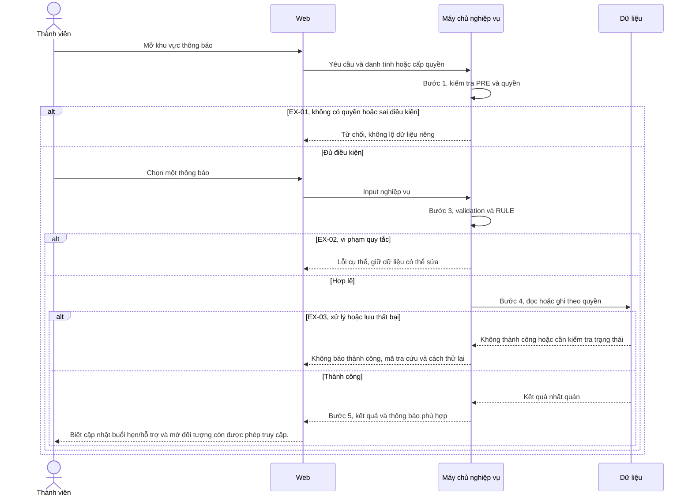

# UC-017: Xem thông báo liên quan

**Version:** 1.1 — 15-11-2026  
**Status:** Draft, chờ duyệt nghiệp vụ; chưa tự coi các PROP/TBD là baseline.  
**Requirement chính:** [GWB-REQ-G1 v1.1](../requirements/GoWithBae_Requirements_G1_v1.1.md)  
**Nguồn khách hàng:** §6.4  
**Truy vết:** FR-21, FR-22; AC-033, AC-034.

## 1. Overview

| Trường | Nội dung |
|---|---|
| Goal | Biết cập nhật buổi hẹn/hỗ trợ và mở đối tượng còn được phép truy cập. |
| Primary Actor | Thành viên |
| Secondary Actors | Máy chủ GoWithBae; dịch vụ email/bản đồ/tệp/lịch chỉ khi thao tác tương ứng cần tích hợp, theo requirement §7 |
| Trigger | Mở khu vực thông báo |
| Scope IN | Xem thông báo liên quan trên web G1 theo các FR liên kết |
| Scope OUT | Chức năng G2, đặt chỗ/thanh toán/app/AI/chat; quyền và thao tác ngoài mục tiêu UC. Điều hướng sang UC khác không tự thực hiện UC đó. |

## 2. Preconditions

- PRE-1: Có phiên tài khoản của người nhận thông báo. Enforce tại bước 1; kiểm tra lại quyền/trạng thái liên quan tại bước 3–4 trước khi trả dữ liệu hoặc ghi.
- PRE-2: Thông báo thuộc tài khoản hiện tại; mở đối tượng vẫn cần quyền hiện thời. Enforce tại bước 1; kiểm tra lại quyền/trạng thái liên quan tại bước 3–4 trước khi trả dữ liệu hoặc ghi.

## 3. Postconditions

- POST-1: Chỉ thông báo của mình được đọc; mở đối tượng không vượt quyền hiện tại. Được tạo tại bước 4 và phản hồi tại bước 5.
- POST-2: Quyền riêng tư/phạm vi được giữ; không thay dữ liệu ngoài mục tiêu hoặc thông báo thành công khi bước 4 thất bại. Enforce bước 1, 3–5 và EX-01–04.
- Nếu use case thất bại: không ghi kết quả nghiệp vụ dở dang như đã hoàn tất; dữ liệu đã lưu thành công không bị báo chưa lưu chỉ vì lỗi thông báo/analytics sau đó.

## 4. Main Flow

| Bước | Actor | Hành động | System Response |
|---|---|---|---|
| 1 | Thành viên | Mở khu vực thông báo | Kiểm tra phiên và người nhận, không nạp thông báo tài khoản khác. |
| 2 | Thành viên | Chọn một thông báo | Lấy nội dung tối thiểu và đối tượng liên quan. |
| 3 | Thành viên | Mở đối tượng | Kiểm tra quyền hiện thời trên plan/ticket/grant; thông báo cũ không tái cấp quyền đã thu hồi. |
| 4 | Thành viên | Đọc nội dung được phép | Trả đối tượng hiện tại, ghi trạng thái đọc nếu chức năng này đã duyệt. |
| 5 | Thành viên | Quay lại thông báo | Hiển thị kết quả; email xử lý/tiếp thị theo cấu hình riêng; lời nhắc trong web theo UC-014, chưa bổ sung email/push nhắc hẹn. |

Các xử lý kiểm tra, truy vấn/ghi, chuyển trạng thái, thông báo và analytics trong cột System Response do hệ thống thực hiện, không do actor tự gán trạng thái/quyền.

## 5. Alternate Flows

**AF-01 — Hướng đi hợp lệ khác:** Tại bước 2, chỉ xem danh sách mà không mở đối tượng → kết thúc ở bước 5, không thay đổi dữ liệu kế hoạch/hỗ trợ.

## 6. Exception Flows

**EX-01 — PRE/quyền không đạt.**
- Trigger: không đạt một trong PRE, danh tính/quyền/cấp quyền hết hiệu lực hoặc tài nguyên không được đọc.
- At step 1 hoặc kiểm tra lại bước 3–4: từ chối và không trả dữ liệu riêng; không chỉ ẩn nút phía client.
- Recovery: với thao tác tài khoản, đăng nhập lại khi cần; với khách nhận link, chỉ cần link/phiên khách hợp lệ, không bắt đăng nhập để xem. Xin mời lại/liên hệ người có quyền rồi bắt đầu bước 1; không lách bằng đổi id.

**EX-02 — Vi phạm đầu vào hoặc quy tắc nghiệp vụ.**
- Trigger: Thông báo không thuộc mình hoặc quyền target đã mất: không trả nội dung nhạy cảm; hiển thị không còn truy cập được. Lỗi gửi email không tạo quyền khác hoặc báo sai trạng thái nghiệp vụ.
- At step 3; kiểm tra biên/trạng thái lại trước ghi tại bước 4. Không ghi kết quả sai; giải thích trường hoặc điều kiện không đạt.
- Recovery: sửa đầu vào ở bước 2, hoặc nạp trạng thái mới từ bước 1 rồi thử lại; OQ chặn phải được PO quyết định, không tự đặt mặc định.

**EX-03 — Đọc/ghi hoặc tích hợp phục vụ nghiệp vụ thất bại.**
- Trigger: timeout, dịch vụ cần thiết không đáp ứng, thao tác đồng thời làm dữ liệu thay đổi hoặc kết quả ghi chưa rõ.
- At step 4: không trả “thành công” khi chưa có kết quả chắc chắn; hiển thị mã tra cứu và giữ input an toàn có thể dùng lại.
- Recovery: kiểm tra trạng thái hiện tại trước retry thao tác ghi để không tạo lặp; đọc có thể thử lại; lỗi kéo dài chuyển vận hành tra mã. Với tích hợp có fallback cụ thể, dùng AF-01/requirement §7 thay vì tự bịa dữ liệu.

**EX-04 — Phản hồi/side effect sau thành công gặp lỗi.**
- Trigger: mất kết nối khi trả kết quả, lỗi thông báo/email/analytics cần thiết sau khi kết quả nghiệp vụ đã được xác lập.
- At step 5: giữ kết quả đã lưu, không báo sai thành thất bại nghiệp vụ và không lộ bí mật trong log.
- Recovery: tải lại/tra trạng thái; vận hành theo dõi và retry phần gửi/ghi sự kiện với mã chống trùng. Không tự tạo lại đối tượng nghiệp vụ chỉ để gửi lại thông báo.

## 7. Business Rules

Định nghĩa đầy đủ tại requirement chính §5. Quy tắc áp dụng vào bước và handler dưới đây; exception phải giữ đúng hậu điều kiện riêng của UC, không coi mọi lỗi đều rollback thao tác đã hoàn tất.

| Rule ID | Description và xử lý khi vi phạm | Applies At Step / handler |
|---|---|---|
| RULE-12 | Link khó đoán, không index; hết hạn/thu hồi không cho truy cập; phiên khách riêng phụ thuộc cấp quyền còn hiệu lực Khi vi phạm: Báo link không hợp lệ; không lộ nội dung; chủ tạo mời lại. Hạn 7 ngày là đề xuất; OQ-07, OQ-09 | Bước 1/3–4; EX-01/EX-02/EX-03 |
| RULE-14 | Chủ tạo được sửa/hủy, người nhận chỉ xem; kiểm tra quyền tại máy chủ Khi vi phạm: Từ chối sửa/hủy của người khác; không chỉ ẩn nút. Chuyển kế hoạch đã qua giờ: OQ-10 | Bước 1/3–4; EX-01/EX-02/EX-03 |
| RULE-19 | Hỗ trợ chỉ thành viên; phân biệt phản hồi khách với ghi chú nội bộ Khi vi phạm: Người ngoài không đọc/trả lời; ghi chú nội bộ không trả ra giao diện khách; trạng thái đóng OQ-13 | Bước 1/3–4; EX-01/EX-02/EX-03 |
| RULE-24 | Thông báo đúng đối tượng, tiếp thị có lựa chọn riêng; chia sẻ không lộ dữ liệu ngoài phạm vi Khi vi phạm: Không gửi khi thiếu quyền; lỗi thông báo không được làm người dùng tưởng thao tác nghiệp vụ chưa được lưu | Bước 3–5; EX-02/EX-03/EX-04 |

## 8. Data Requirements

**Input và validation:**

- notification_id: thuộc người nhận; loại cập nhật plan/hỗ trợ.
- target_id: máy chủ kiểm tra quyền đối tượng khi mở.
- read_action: chỉ nếu thiết kế đọc/chưa đọc đã được duyệt OQ-14.

**Output / state:** Chỉ thông báo của mình được đọc; mở đối tượng không vượt quyền hiện tại. Dữ liệu nghiệp vụ chi tiết tại requirement §6; giới hạn chưa có số phải theo OQ-21, không tự gán giá trị.

**Sequence diagram:** [file Mermaid](./UC-017-read-notifications.mermaid).

**State machine:** UC này không thêm vòng đời trạng thái riêng. Nếu tham chiếu một entity có trạng thái, áp dụng state machine ở requirement §7; không tạo trạng thái giả chỉ để vẽ sơ đồ.

## 9. Open Questions

OQ-09, OQ-14

Owner, mốc quyết định và mức chặn được ghi tại requirement §13. UC chỉ được baseline sau khi các câu hỏi ảnh hưởng tới nhánh triển khai đã được trả lời hoặc nhánh đó được PO loại khỏi phạm vi rõ ràng.

## 10. Notes và Acceptance Criteria

- Đây là đặc tả yêu cầu, chưa xây phần mềm; nội dung CR-001 mang nhãn CONF, phần PROP/TBD khác vẫn chưa được duyệt; không có bằng chứng kiểm thử runtime.
- Không chọn framework/API/token cụ thể; task tham chiếu hành vi và validation thay vì khóa giải pháp sớm.
- Source/DER/PROP/TBD tuân quy ước requirement chính; cần đọc OQ trước khi dùng làm input coding agent.

| Mã | Given | When | Then |
|---|---|---|---|
| AC-033 | Có thông báo về plan đã bị thu hồi chia sẻ | mở liên kết trong thông báo | không xem được plan bằng thông báo cũ |
| AC-034 | Người dùng chưa chọn nhận tiếp thị | có sự kiện hỗ trợ cần thiết | không tự biến đồng ý nhận hỗ trợ thành đồng ý tiếp thị |

Ngoài các ví dụ Given/When/Then này, QA phải kiểm thử EX-01–04, các RULE áp dụng và boundary sau khi OQ đã được quyết định; danh sách này không thay thế toàn bộ kế hoạch kiểm thử. Các nội dung CR-001 đã CONF, chỉ chi tiết còn mở mới cần OQ.

## Verification Report — UC-017

### Blocking Issues / Open Questions cần unblock

OQ-09, OQ-14

Các OQ có mức chặn ở requirement §13 ảnh hưởng trực tiếp bước 3–4. Không kết luận “ready to code” khi chưa chốt chính sách liên quan.

### Warnings

- Giới hạn input, cấu hình dịch vụ/quyền/retention phải duyệt theo phạm vi; task chưa phải ước lượng ngày công hay giải pháp cuối.
- Sơ đồ diễn tả luồng chính và nhánh lỗi; chi tiết AF/EX bằng văn bản là một phần đặc tả bắt buộc.

### Passed — kiểm tra tài liệu, không phải test hệ thống

- Mỗi PRE có kiểm tra ở bước 1 và kiểm tra lại trước kết quả tại bước 3–4.
- POST-1 có xử lý ở bước 4–5; POST-2 được giữ bởi kiểm tra quyền và EX-01–04.
- RULE có bước áp dụng và handler; AF có điểm quay lại/kết thúc; EX có Recovery.
- Một primary actor và một mục tiêu; không có bước thực thi chức năng G2.
- Trạng thái có điều kiện vào/ra hoặc trạng thái kết thúc có chủ ý; PROP/TBD không được coi là chính sách đã duyệt.
