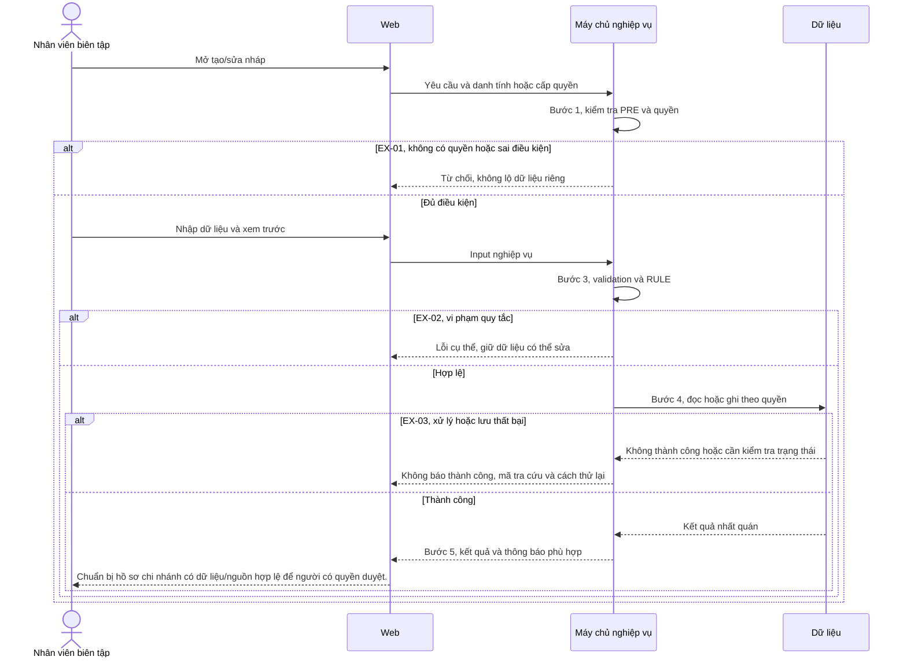
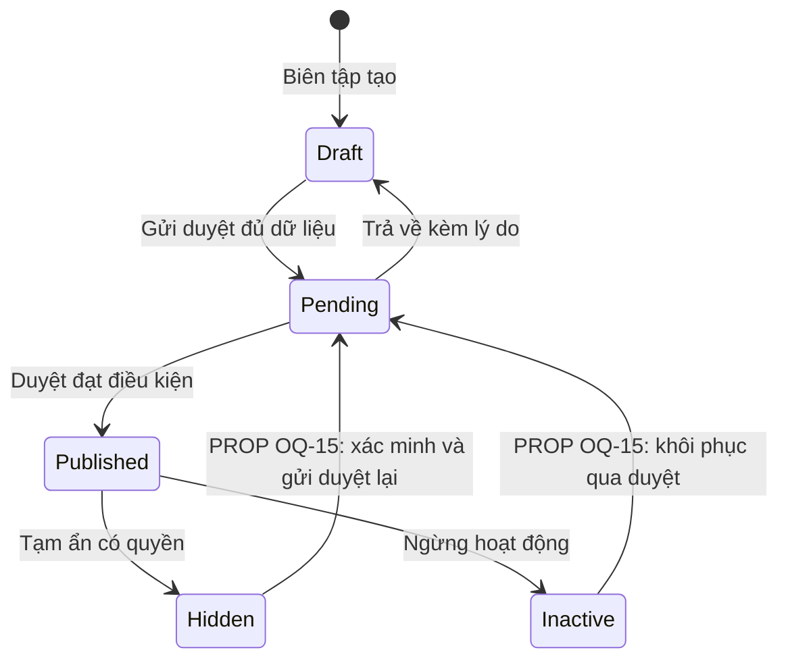

# UC-018: Biên tập và gửi duyệt địa điểm

**Version:** 1.1 — 15-11-2026  
**Status:** Draft, chờ duyệt nghiệp vụ; chưa tự coi các PROP/TBD là baseline.  
**Requirement chính:** [GWB-REQ-G1 v1.1](../requirements/GoWithBae_Requirements_G1_v1.1.md)  
**Nguồn khách hàng:** §4.1–4.2, §7/A01  
**Truy vết:** FR-23, FR-31; AC-035, AC-036.

## 1. Overview

| Trường | Nội dung |
|---|---|
| Goal | Chuẩn bị hồ sơ chi nhánh có dữ liệu/nguồn hợp lệ để người có quyền duyệt. |
| Primary Actor | Nhân viên biên tập |
| Secondary Actors | Máy chủ GoWithBae; dịch vụ email/bản đồ/tệp/lịch chỉ khi thao tác tương ứng cần tích hợp, theo requirement §7 |
| Trigger | Mở tạo/sửa nháp |
| Scope IN | Biên tập và gửi duyệt địa điểm trên web G1 theo các FR liên kết |
| Scope OUT | Chức năng G2, đặt chỗ/thanh toán/app/AI/chat; quyền và thao tác ngoài mục tiêu UC. Điều hướng sang UC khác không tự thực hiện UC đó. |

## 2. Preconditions

- PRE-1: Phiên nhân viên hợp lệ, có quyền tạo/sửa nháp và điều kiện xác thực nhân viên theo môi trường. Enforce tại bước 1; kiểm tra lại quyền/trạng thái liên quan tại bước 3–4 trước khi trả dữ liệu hoặc ghi.
- PRE-2: Tài liệu/ảnh nào được sử dụng phải có quyền; nháp được phép chưa đủ ảnh/dữ liệu xuất bản. Bản sửa công khai theo OQ-15. Enforce tại bước 1; kiểm tra lại quyền/trạng thái liên quan tại bước 3–4 trước khi trả dữ liệu hoặc ghi.

## 3. Postconditions

- POST-1: Bản nháp/Chờ duyệt có dữ liệu và truy nguyên; không thay thế bản công khai ngoài quy trình duyệt. Được tạo tại bước 4 và phản hồi tại bước 5.
- POST-2: Quyền riêng tư/phạm vi được giữ; không thay dữ liệu ngoài mục tiêu hoặc thông báo thành công khi bước 4 thất bại. Enforce bước 1, 3–5 và EX-01–04.
- Nếu use case thất bại: không ghi kết quả nghiệp vụ dở dang như đã hoàn tất; dữ liệu đã lưu thành công không bị báo chưa lưu chỉ vì lỗi thông báo/analytics sau đó.

## 4. Main Flow

| Bước | Actor | Hành động | System Response |
|---|---|---|---|
| 1 | Nhân viên biên tập | Mở tạo/sửa nháp | Kiểm tra phiên, vai trò biên tập và bản nháp đang cho phép sửa. |
| 2 | Nhân viên biên tập | Nhập dữ liệu và xem trước | Nhận hồ sơ/ảnh/nguồn, giữ unknown đúng nghĩa; xem trước không xuất bản. |
| 3 | Nhân viên biên tập | Gửi duyệt | Kiểm tra trường xuất bản, tọa độ/giá/giờ/ảnh có quyền và dấu hiệu trùng chi nhánh. |
| 4 | Nhân viên biên tập | Lưu nháp và trạng thái | Ghi dữ liệu, chuyển Chờ duyệt khi đủ điều kiện; lưu người thực hiện và nhật ký thay đổi quan trọng. |
| 5 | Nhân viên biên tập | Xem kết quả | Trả mã/trạng thái và lỗi cần sửa; chỉ bản đã được duyệt mới ra công khai. |

Các xử lý kiểm tra, truy vấn/ghi, chuyển trạng thái, thông báo và analytics trong cột System Response do hệ thống thực hiện, không do actor tự gán trạng thái/quyền.

## 5. Alternate Flows

**AF-01 — Hướng đi hợp lệ khác:** Tại bước 2, chưa đủ dữ liệu → lưu Nháp thay vì gửi duyệt, vẫn báo phần thiếu; tiếp tục chỉnh ở bước 2 sau. Bản chỉnh sửa nơi đã công khai tuân OQ-15.

## 6. Exception Flows

**EX-01 — PRE/quyền không đạt.**
- Trigger: không đạt một trong PRE, danh tính/quyền/cấp quyền hết hiệu lực hoặc tài nguyên không được đọc.
- At step 1 hoặc kiểm tra lại bước 3–4: từ chối và không trả dữ liệu riêng; không chỉ ẩn nút phía client.
- Recovery: với thao tác tài khoản, đăng nhập lại khi cần; với khách nhận link, chỉ cần link/phiên khách hợp lệ, không bắt đăng nhập để xem. Xin mời lại/liên hệ người có quyền rồi bắt đầu bước 1; không lách bằng đổi id.

**EX-02 — Vi phạm đầu vào hoặc quy tắc nghiệp vụ.**
- Trigger: Thiếu trường để xuất bản, ảnh không có quyền/tệp sai, mã/toạ độ/giá không hợp lệ: không chuyển sang công khai/chờ duyệt sai; cho sửa dữ liệu. Biên tập gọi thao tác xuất bản trực tiếp bị chặn.
- At step 3; kiểm tra biên/trạng thái lại trước ghi tại bước 4. Không ghi kết quả sai; giải thích trường hoặc điều kiện không đạt.
- Recovery: sửa đầu vào ở bước 2, hoặc nạp trạng thái mới từ bước 1 rồi thử lại; OQ chặn phải được PO quyết định, không tự đặt mặc định.

**EX-03 — Đọc/ghi hoặc tích hợp phục vụ nghiệp vụ thất bại.**
- Trigger: timeout, dịch vụ cần thiết không đáp ứng, thao tác đồng thời làm dữ liệu thay đổi hoặc kết quả ghi chưa rõ.
- At step 4: không trả “thành công” khi chưa có kết quả chắc chắn; hiển thị mã tra cứu và giữ input an toàn có thể dùng lại.
- Recovery: kiểm tra trạng thái hiện tại trước retry thao tác ghi để không tạo lặp; đọc có thể thử lại; lỗi kéo dài chuyển vận hành tra mã. Với tích hợp có fallback cụ thể, dùng AF-01/requirement §7 thay vì tự bịa dữ liệu.

**EX-04 — Phản hồi/side effect sau thành công gặp lỗi.**
- Trigger: mất kết nối khi trả kết quả, lỗi thông báo/email/analytics cần thiết sau khi kết quả nghiệp vụ đã được xác lập.
- At step 5: giữ kết quả đã lưu, không báo sai thành thất bại nghiệp vụ và không lộ bí mật trong log.
- Recovery: tải lại/tra trạng thái; vận hành theo dõi và retry phần gửi/ghi sự kiện với mã chống trùng. Không tự tạo lại đối tượng nghiệp vụ chỉ để gửi lại thông báo.

## 7. Business Rules

Định nghĩa đầy đủ tại requirement chính §5. Quy tắc áp dụng vào bước và handler dưới đây; exception phải giữ đúng hậu điều kiện riêng của UC, không coi mọi lỗi đều rollback thao tác đã hoàn tất.

| Rule ID | Description và xử lý khi vi phạm | Applies At Step / handler |
|---|---|---|
| RULE-04 | Không có dữ liệu giá/giờ/tiện ích không đồng nghĩa bằng 0/đang mở/không có Khi vi phạm: Hiển thị “Chưa có thông tin”; không thỏa bộ lọc cần chứng minh thuộc tính đó | Bước 1/3–4; EX-01/EX-02/EX-03 |
| RULE-20 | Xuất bản cần tên, loại hình, địa chỉ, tọa độ, mô tả, ảnh có quyền, hoạt động chính, trạng thái giá/giờ, nguồn/ngày kiểm tra và kiểm tra trùng Khi vi phạm: Thiếu thì giữ nháp/chờ duyệt, liệt kê lỗi; không bắt buộc biết giá/giờ thực nếu đã ghi chưa rõ | Bước 1/3–4; EX-01/EX-02/EX-03 |
| RULE-21 | Biên tập không tự xuất bản; quản lý quyền, duyệt/ẩn/giá/khóa có nhật ký Khi vi phạm: Từ chối thao tác vượt quyền; thay đổi quan trọng không được mất dấu vết; vai trò kép OQ-18 | Bước 1/3–4; EX-01/EX-02/EX-03 |
| RULE-22 | Không xóa lịch sử địa điểm đã tham chiếu; nhãn ngừng dùng không làm mất dữ liệu cũ Khi vi phạm: Chặn xóa phá tham chiếu; dùng trạng thái/vô hiệu hóa phù hợp | Bước 3–4; EX-02/EX-03 |
| RULE-27 | Tệp giới hạn định dạng/kích thước, kiểm tra nội dung; không công khai token/khóa; nhân viên dùng 2 bước trước vận hành Khi vi phạm: Tệp bị từ chối không tạo liên kết công khai; lỗi có mã tra cứu, không trả bí mật | Bước 1/3–4; EX-01/EX-02/EX-03 |
| RULE-28 | Chỉ dữ liệu có quyền sử dụng được công bố; minh họa phải gắn nhãn và tách môi trường thật Khi vi phạm: Không xuất bản ảnh không có quyền; không dùng dữ liệu giả làm số liệu kinh doanh | Bước 1/3–4; EX-01/EX-02/EX-03 |

## 8. Data Requirements

**Input và validation:**

- place fields: mã chi nhánh, tên, loại hình, địa chỉ, khu vực, tọa độ, mô tả, hoạt động chính.
- price/hour_status: known/unknown bắt buộc, dữ liệu thực theo trạng thái, nguồn và ngày kiểm tra.
- images: ít nhất một ảnh có quyền trước gửi xuất bản; metadata nguồn/quyền, thứ tự/ảnh đại diện.
- draft_id: đúng bản được quyền sửa, không ghi đè công khai bỏ duyệt.

**Output / state:** Bản nháp/Chờ duyệt có dữ liệu và truy nguyên; không thay thế bản công khai ngoài quy trình duyệt. Dữ liệu nghiệp vụ chi tiết tại requirement §6; giới hạn chưa có số phải theo OQ-21, không tự gán giá trị.

**Sequence diagram:** [file Mermaid](./UC-018-edit-place-draft.mermaid).

**State machine:** [file Mermaid riêng](./UC-018-edit-place-draft-state.mermaid). Trạng thái/transition PROP/TBD cần PO duyệt; trạng thái kết thúc có chủ ý không phải orphan.

## 9. Open Questions

OQ-03, OQ-04, OQ-15, OQ-18, OQ-21

Owner, mốc quyết định và mức chặn được ghi tại requirement §13. UC chỉ được baseline sau khi các câu hỏi ảnh hưởng tới nhánh triển khai đã được trả lời hoặc nhánh đó được PO loại khỏi phạm vi rõ ràng.

## 10. Notes và Acceptance Criteria

- Đây là đặc tả yêu cầu, chưa xây phần mềm; nội dung CR-001 mang nhãn CONF, phần PROP/TBD khác vẫn chưa được duyệt; không có bằng chứng kiểm thử runtime.
- Không chọn framework/API/token cụ thể; task tham chiếu hành vi và validation thay vì khóa giải pháp sớm.
- Source/DER/PROP/TBD tuân quy ước requirement chính; cần đọc OQ trước khi dùng làm input coding agent.

| Mã | Given | When | Then |
|---|---|---|---|
| AC-035 | Nơi unknown giá/giờ nhưng đủ trạng thái, nguồn và các trường xuất bản khác | gửi duyệt | không tự gán giá/giờ và vẫn chuyển Chờ duyệt khi đủ điều kiện |
| AC-036 | Ảnh không có quyền hoặc thiếu tọa độ | gửi duyệt | báo lỗi trường và không xuất bản |

Ngoài các ví dụ Given/When/Then này, QA phải kiểm thử EX-01–04, các RULE áp dụng và boundary sau khi OQ đã được quyết định; danh sách này không thay thế toàn bộ kế hoạch kiểm thử. Các nội dung CR-001 đã CONF, chỉ chi tiết còn mở mới cần OQ.

## Verification Report — UC-018

### Blocking Issues / Open Questions cần unblock

OQ-03, OQ-04, OQ-15, OQ-18, OQ-21

Các OQ có mức chặn ở requirement §13 ảnh hưởng trực tiếp bước 3–4. Không kết luận “ready to code” khi chưa chốt chính sách liên quan.

### Warnings

- Giới hạn input, cấu hình dịch vụ/quyền/retention phải duyệt theo phạm vi; task chưa phải ước lượng ngày công hay giải pháp cuối.
- Sơ đồ diễn tả luồng chính và nhánh lỗi; chi tiết AF/EX bằng văn bản là một phần đặc tả bắt buộc.

### Passed — kiểm tra tài liệu, không phải test hệ thống

- Mỗi PRE có kiểm tra ở bước 1 và kiểm tra lại trước kết quả tại bước 3–4.
- POST-1 có xử lý ở bước 4–5; POST-2 được giữ bởi kiểm tra quyền và EX-01–04.
- RULE có bước áp dụng và handler; AF có điểm quay lại/kết thúc; EX có Recovery.
- Một primary actor và một mục tiêu; không có bước thực thi chức năng G2.
- Trạng thái có điều kiện vào/ra hoặc trạng thái kết thúc có chủ ý; PROP/TBD không được coi là chính sách đã duyệt.
