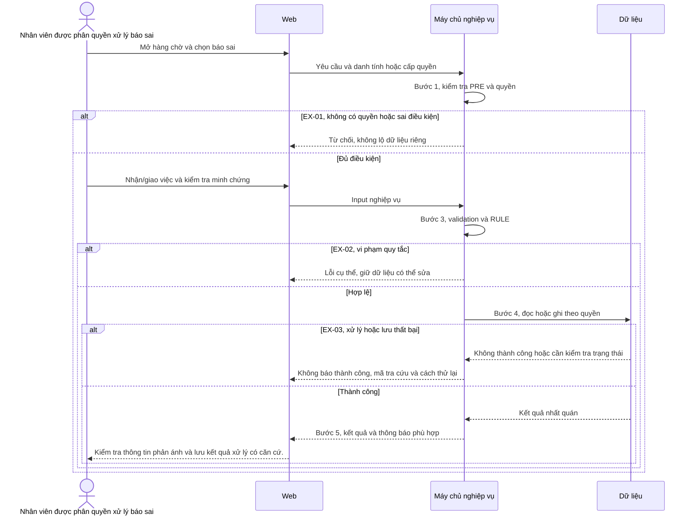
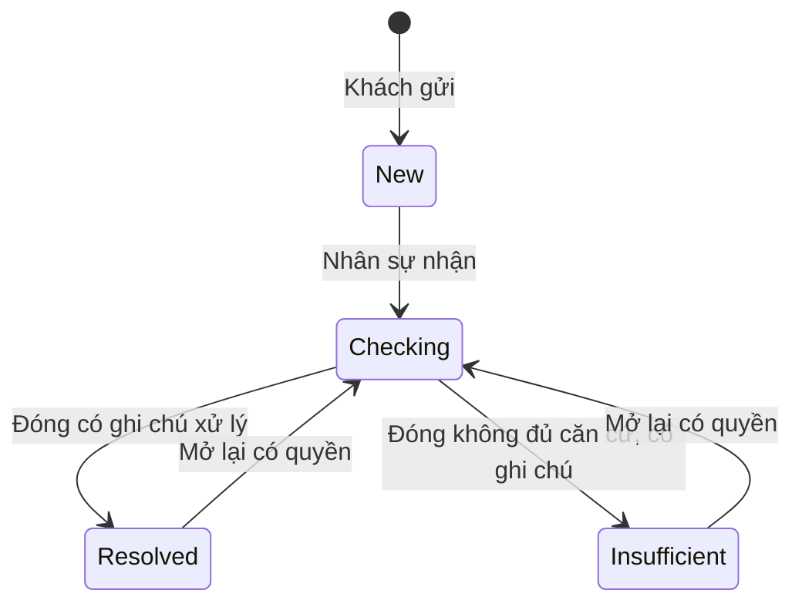

# UC-024: Xử lý báo sai địa điểm

**Version:** 1.1 — 15-11-2026  
**Status:** Draft, chờ duyệt nghiệp vụ; chưa tự coi các PROP/TBD là baseline.  
**Requirement chính:** [GWB-REQ-G1 v1.1](../requirements/GoWithBae_Requirements_G1_v1.1.md)  
**Nguồn khách hàng:** §6.2, §7/A05  
**Truy vết:** FR-28, FR-31; AC-047, AC-048.

## 1. Overview

| Trường | Nội dung |
|---|---|
| Goal | Kiểm tra thông tin phản ánh và lưu kết quả xử lý có căn cứ. |
| Primary Actor | Nhân viên được phân quyền xử lý báo sai |
| Secondary Actors | Máy chủ GoWithBae; dịch vụ email/bản đồ/tệp/lịch chỉ khi thao tác tương ứng cần tích hợp, theo requirement §7 |
| Trigger | Mở hàng chờ và chọn báo sai |
| Scope IN | Xử lý báo sai địa điểm trên web G1 theo các FR liên kết |
| Scope OUT | Chức năng G2, đặt chỗ/thanh toán/app/AI/chat; quyền và thao tác ngoài mục tiêu UC. Điều hướng sang UC khác không tự thực hiện UC đó. |

## 2. Preconditions

- PRE-1: Phiên nhân viên có quyền xem/nhận/chuyển trạng thái báo sai trong phạm vi. Enforce tại bước 1; kiểm tra lại quyền/trạng thái liên quan tại bước 3–4 trước khi trả dữ liệu hoặc ghi.
- PRE-2: Sửa/xuất bản địa điểm đòi quyền riêng, không được thay thế bằng quyền xử lý báo sai. Enforce tại bước 1; kiểm tra lại quyền/trạng thái liên quan tại bước 3–4 trước khi trả dữ liệu hoặc ghi.

## 3. Postconditions

- POST-1: Báo sai có kết quả/ghi chú và lịch sử; thay đổi địa điểm nếu có vẫn qua quy trình xuất bản. Được tạo tại bước 4 và phản hồi tại bước 5.
- POST-2: Quyền riêng tư/phạm vi được giữ; không thay dữ liệu ngoài mục tiêu hoặc thông báo thành công khi bước 4 thất bại. Enforce bước 1, 3–5 và EX-01–04.
- Nếu use case thất bại: không ghi kết quả nghiệp vụ dở dang như đã hoàn tất; dữ liệu đã lưu thành công không bị báo chưa lưu chỉ vì lỗi thông báo/analytics sau đó.

## 4. Main Flow

| Bước | Actor | Hành động | System Response |
|---|---|---|---|
| 1 | Nhân viên được phân quyền xử lý báo sai | Mở hàng chờ và chọn báo sai | Kiểm tra quyền/phạm vi, nạp trạng thái và người phụ trách. |
| 2 | Nhân viên được phân quyền xử lý báo sai | Nhận/giao việc và kiểm tra minh chứng | Chuyển Đang kiểm tra; hiển thị nội dung/ảnh theo quyền. |
| 3 | Nhân viên được phân quyền xử lý báo sai | Chọn kết quả và ghi chú | Kiểm tra chuyển trạng thái, quyền mở lại, ghi chú bắt buộc; sửa nơi phải qua UC-018/019 đúng quyền. |
| 4 | Nhân viên được phân quyền xử lý báo sai | Lưu xử lý | Ghi kết quả Đã xử lý/Không đủ căn cứ hoặc mở lại, người/thời gian/ghi chú và audit quan trọng. |
| 5 | Nhân viên được phân quyền xử lý báo sai | Xem hàng chờ cập nhật | Giữ lịch sử, phản hồi/thông báo nếu chính sách đã duyệt; báo sai không tự sửa dữ liệu công khai. |

Các xử lý kiểm tra, truy vấn/ghi, chuyển trạng thái, thông báo và analytics trong cột System Response do hệ thống thực hiện, không do actor tự gán trạng thái/quyền.

## 5. Alternate Flows

**AF-01 — Hướng đi hợp lệ khác:** Tại bước 3, cần thêm căn cứ → giữ Đang kiểm tra, không đóng. Báo sai đã đóng có thể mở lại theo quyền → quay lại bước 2.

## 6. Exception Flows

**EX-01 — PRE/quyền không đạt.**
- Trigger: không đạt một trong PRE, danh tính/quyền/cấp quyền hết hiệu lực hoặc tài nguyên không được đọc.
- At step 1 hoặc kiểm tra lại bước 3–4: từ chối và không trả dữ liệu riêng; không chỉ ẩn nút phía client.
- Recovery: với thao tác tài khoản, đăng nhập lại khi cần; với khách nhận link, chỉ cần link/phiên khách hợp lệ, không bắt đăng nhập để xem. Xin mời lại/liên hệ người có quyền rồi bắt đầu bước 1; không lách bằng đổi id.

**EX-02 — Vi phạm đầu vào hoặc quy tắc nghiệp vụ.**
- Trigger: Đóng không ghi chú, sai quyền/trạng thái hoặc cố sửa công khai khi không có quyền duyệt: từ chối; bổ sung ghi chú/chuyển người có quyền rồi thử lại.
- At step 3; kiểm tra biên/trạng thái lại trước ghi tại bước 4. Không ghi kết quả sai; giải thích trường hoặc điều kiện không đạt.
- Recovery: sửa đầu vào ở bước 2, hoặc nạp trạng thái mới từ bước 1 rồi thử lại; OQ chặn phải được PO quyết định, không tự đặt mặc định.

**EX-03 — Đọc/ghi hoặc tích hợp phục vụ nghiệp vụ thất bại.**
- Trigger: timeout, dịch vụ cần thiết không đáp ứng, thao tác đồng thời làm dữ liệu thay đổi hoặc kết quả ghi chưa rõ.
- At step 4: không trả “thành công” khi chưa có kết quả chắc chắn; hiển thị mã tra cứu và giữ input an toàn có thể dùng lại.
- Recovery: kiểm tra trạng thái hiện tại trước retry thao tác ghi để không tạo lặp; đọc có thể thử lại; lỗi kéo dài chuyển vận hành tra mã. Với tích hợp có fallback cụ thể, dùng AF-01/requirement §7 thay vì tự bịa dữ liệu.

**EX-04 — Phản hồi/side effect sau thành công gặp lỗi.**
- Trigger: mất kết nối khi trả kết quả, lỗi thông báo/email/analytics cần thiết sau khi kết quả nghiệp vụ đã được xác lập.
- At step 5: giữ kết quả đã lưu, không báo sai thành thất bại nghiệp vụ và không lộ bí mật trong log.
- Recovery: tải lại/tra trạng thái; vận hành theo dõi và retry phần gửi/ghi sự kiện với mã chống trùng. Không tự tạo lại đối tượng nghiệp vụ chỉ để gửi lại thông báo.

## 7. Business Rules

Định nghĩa đầy đủ tại requirement chính §5. Quy tắc áp dụng vào bước và handler dưới đây; exception phải giữ đúng hậu điều kiện riêng của UC, không coi mọi lỗi đều rollback thao tác đã hoàn tất.

| Rule ID | Description và xử lý khi vi phạm | Applies At Step / handler |
|---|---|---|
| RULE-18 | Báo sai được gửi ẩn danh có chống lạm dụng; không sửa công khai tự động; đóng có ghi chú Khi vi phạm: Quá hạn mức chặn và cho biết cách thử lại; thiếu ghi chú chặn đóng; mở lại theo quyền | Bước 1/3–4; EX-01/EX-02/EX-03 |
| RULE-20 | Xuất bản cần tên, loại hình, địa chỉ, tọa độ, mô tả, ảnh có quyền, hoạt động chính, trạng thái giá/giờ, nguồn/ngày kiểm tra và kiểm tra trùng Khi vi phạm: Thiếu thì giữ nháp/chờ duyệt, liệt kê lỗi; không bắt buộc biết giá/giờ thực nếu đã ghi chưa rõ | Bước 1/3–4; EX-01/EX-02/EX-03 |
| RULE-21 | Biên tập không tự xuất bản; quản lý quyền, duyệt/ẩn/giá/khóa có nhật ký Khi vi phạm: Từ chối thao tác vượt quyền; thay đổi quan trọng không được mất dấu vết; vai trò kép OQ-18 | Bước 1/3–4; EX-01/EX-02/EX-03 |
| RULE-24 | Thông báo đúng đối tượng, tiếp thị có lựa chọn riêng; chia sẻ không lộ dữ liệu ngoài phạm vi Khi vi phạm: Không gửi khi thiếu quyền; lỗi thông báo không được làm người dùng tưởng thao tác nghiệp vụ chưa được lưu | Bước 3–5; EX-02/EX-03/EX-04 |

## 8. Data Requirements

**Input và validation:**

- report_id: báo sai trong phạm vi; assignee: nhân viên hợp lệ khi giao việc.
- status: Mới/Đang kiểm tra/Đã xử lý/Không đủ căn cứ.
- resolution_note: ghi chú bắt buộc khi đóng; reopening: chỉ người có quyền.

**Output / state:** Báo sai có kết quả/ghi chú và lịch sử; thay đổi địa điểm nếu có vẫn qua quy trình xuất bản. Dữ liệu nghiệp vụ chi tiết tại requirement §6; giới hạn chưa có số phải theo OQ-21, không tự gán giá trị.

**Sequence diagram:** [file Mermaid](./UC-024-handle-place-reports.mermaid).

**State machine:** [file Mermaid riêng](./UC-024-handle-place-reports-state.mermaid). Trạng thái/transition PROP/TBD cần PO duyệt; trạng thái kết thúc có chủ ý không phải orphan.

## 9. Open Questions

OQ-14, OQ-18

Owner, mốc quyết định và mức chặn được ghi tại requirement §13. UC chỉ được baseline sau khi các câu hỏi ảnh hưởng tới nhánh triển khai đã được trả lời hoặc nhánh đó được PO loại khỏi phạm vi rõ ràng.

## 10. Notes và Acceptance Criteria

- Đây là đặc tả yêu cầu, chưa xây phần mềm; nội dung CR-001 mang nhãn CONF, phần PROP/TBD khác vẫn chưa được duyệt; không có bằng chứng kiểm thử runtime.
- Không chọn framework/API/token cụ thể; task tham chiếu hành vi và validation thay vì khóa giải pháp sớm.
- Source/DER/PROP/TBD tuân quy ước requirement chính; cần đọc OQ trước khi dùng làm input coding agent.

| Mã | Given | When | Then |
|---|---|---|---|
| AC-047 | Báo sai đang kiểm tra | đóng mà không có ghi chú | bị chặn và báo cần ghi chú xử lý |
| AC-048 | Nhân sự có quyền mở lại báo sai đã đóng | mở lại | quay về kiểm tra và vẫn giữ kết quả/lịch sử trước |

Ngoài các ví dụ Given/When/Then này, QA phải kiểm thử EX-01–04, các RULE áp dụng và boundary sau khi OQ đã được quyết định; danh sách này không thay thế toàn bộ kế hoạch kiểm thử. Các nội dung CR-001 đã CONF, chỉ chi tiết còn mở mới cần OQ.

## Verification Report — UC-024

### Blocking Issues / Open Questions cần unblock

OQ-14, OQ-18

Các OQ có mức chặn ở requirement §13 ảnh hưởng trực tiếp bước 3–4. Không kết luận “ready to code” khi chưa chốt chính sách liên quan.

### Warnings

- Giới hạn input, cấu hình dịch vụ/quyền/retention phải duyệt theo phạm vi; task chưa phải ước lượng ngày công hay giải pháp cuối.
- Sơ đồ diễn tả luồng chính và nhánh lỗi; chi tiết AF/EX bằng văn bản là một phần đặc tả bắt buộc.

### Passed — kiểm tra tài liệu, không phải test hệ thống

- Mỗi PRE có kiểm tra ở bước 1 và kiểm tra lại trước kết quả tại bước 3–4.
- POST-1 có xử lý ở bước 4–5; POST-2 được giữ bởi kiểm tra quyền và EX-01–04.
- RULE có bước áp dụng và handler; AF có điểm quay lại/kết thúc; EX có Recovery.
- Một primary actor và một mục tiêu; không có bước thực thi chức năng G2.
- Trạng thái có điều kiện vào/ra hoặc trạng thái kết thúc có chủ ý; PROP/TBD không được coi là chính sách đã duyệt.
