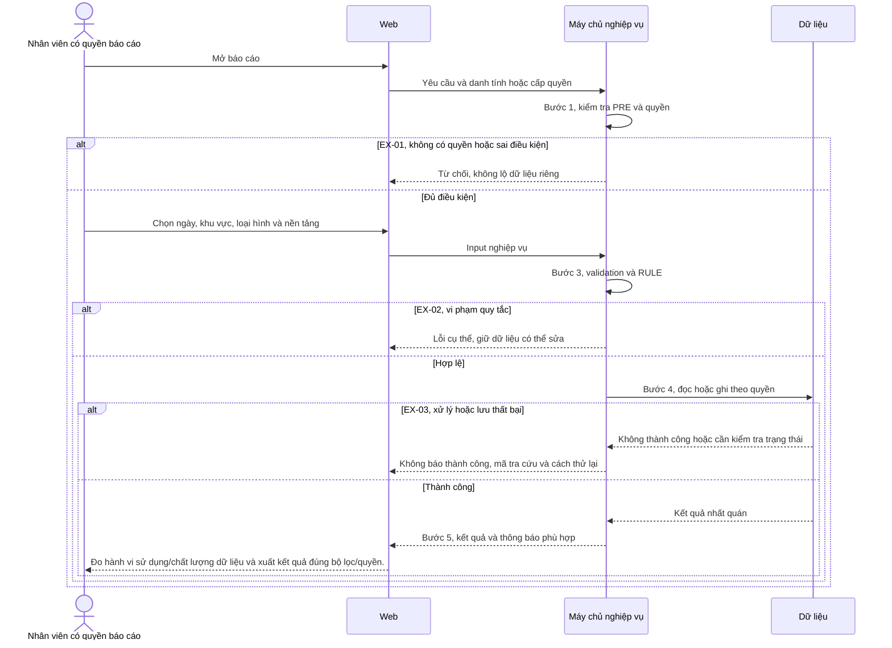

# UC-026: Xem báo cáo và xuất CSV

**Version:** 1.1 — 15-11-2026  
**Status:** Draft, chờ duyệt nghiệp vụ; chưa tự coi các PROP/TBD là baseline.  
**Requirement chính:** [GWB-REQ-G1 v1.1](../requirements/GoWithBae_Requirements_G1_v1.1.md)  
**Nguồn khách hàng:** §7/A06, §10  
**Truy vết:** FR-32, FR-33, FR-34; AC-051, AC-052.

## 1. Overview

| Trường | Nội dung |
|---|---|
| Goal | Đo hành vi sử dụng/chất lượng dữ liệu và xuất kết quả đúng bộ lọc/quyền. |
| Primary Actor | Nhân viên có quyền báo cáo |
| Secondary Actors | Máy chủ GoWithBae; dịch vụ email/bản đồ/tệp/lịch chỉ khi thao tác tương ứng cần tích hợp, theo requirement §7 |
| Trigger | Mở báo cáo |
| Scope IN | Xem báo cáo và xuất CSV trên web G1 theo các FR liên kết |
| Scope OUT | Chức năng G2, đặt chỗ/thanh toán/app/AI/chat; quyền và thao tác ngoài mục tiêu UC. Điều hướng sang UC khác không tự thực hiện UC đó. |

## 2. Preconditions

- PRE-1: Phiên nhân viên có quyền xem báo cáo; xuất đòi quyền riêng. Enforce tại bước 1; kiểm tra lại quyền/trạng thái liên quan tại bước 3–4 trước khi trả dữ liệu hoặc ghi.
- PRE-2: Định nghĩa session/cohort/ngưỡng xác minh và dataset đối chiếu đã duyệt OQ-20. Enforce tại bước 1; kiểm tra lại quyền/trạng thái liên quan tại bước 3–4 trước khi trả dữ liệu hoặc ghi.

## 3. Postconditions

- POST-1: Báo cáo và CSV thống nhất cùng bộ lọc/quyền, theo đúng công thức và không lộ dữ liệu riêng. Được tạo tại bước 4 và phản hồi tại bước 5.
- POST-2: Quyền riêng tư/phạm vi được giữ; không thay dữ liệu ngoài mục tiêu hoặc thông báo thành công khi bước 4 thất bại. Enforce bước 1, 3–5 và EX-01–04.
- Nếu use case thất bại: không ghi kết quả nghiệp vụ dở dang như đã hoàn tất; dữ liệu đã lưu thành công không bị báo chưa lưu chỉ vì lỗi thông báo/analytics sau đó.

## 4. Main Flow

| Bước | Actor | Hành động | System Response |
|---|---|---|---|
| 1 | Nhân viên có quyền báo cáo | Mở báo cáo | Kiểm tra quyền xem và phạm vi dữ liệu; không mặc định mọi nhân viên đều được xem/xuất. |
| 2 | Nhân viên có quyền báo cáo | Chọn ngày, khu vực, loại hình và nền tảng | Giữ bộ lọc, xác định kỳ/cohort và thời điểm cập nhật. |
| 3 | Nhân viên có quyền báo cáo | Áp dụng bộ lọc hoặc xuất | Kiểm tra khoảng ngày/mã/quyền xuất; loại trùng sự kiện, tách tài khoản/khách, không ghi dữ liệu nhạy cảm. |
| 4 | Nhân viên có quyền báo cáo | Tính và xuất kết quả | Tính công thức §10, chất lượng dữ liệu; CSV dùng cùng phạm vi/bộ lọc và chỉ cột cho phép. |
| 5 | Nhân viên có quyền báo cáo | Xem số liệu/tải CSV | Hiển thị dữ liệu cập nhật trong 24 giờ, mẫu số 0/chưa đủ 30 ngày là chưa có/đủ dữ liệu; kết quả đối chiếu được. |

Các xử lý kiểm tra, truy vấn/ghi, chuyển trạng thái, thông báo và analytics trong cột System Response do hệ thống thực hiện, không do actor tự gán trạng thái/quyền.

## 5. Alternate Flows

**AF-01 — Hướng đi hợp lệ khác:** Tại bước 3, chỉ có quyền xem không có quyền xuất → vẫn xem báo cáo hợp lệ, từ chối riêng thao tác CSV. Cohort chưa đủ tuổi → hiển thị chưa đủ dữ liệu ở bước 5, không tính 0%.

## 6. Exception Flows

**EX-01 — PRE/quyền không đạt.**
- Trigger: không đạt một trong PRE, danh tính/quyền/cấp quyền hết hiệu lực hoặc tài nguyên không được đọc.
- At step 1 hoặc kiểm tra lại bước 3–4: từ chối và không trả dữ liệu riêng; không chỉ ẩn nút phía client.
- Recovery: với thao tác tài khoản, đăng nhập lại khi cần; với khách nhận link, chỉ cần link/phiên khách hợp lệ, không bắt đăng nhập để xem. Xin mời lại/liên hệ người có quyền rồi bắt đầu bước 1; không lách bằng đổi id.

**EX-02 — Vi phạm đầu vào hoặc quy tắc nghiệp vụ.**
- Trigger: Khoảng ngày/mã sai, xem vượt quyền, xuất không quyền hoặc dữ liệu xuất lỗi: không xuất phần ngoài phạm vi, báo lỗi/thử lại. Event lặp không tăng tổng; dữ liệu chưa có không biến thành tỷ lệ giả.
- At step 3; kiểm tra biên/trạng thái lại trước ghi tại bước 4. Không ghi kết quả sai; giải thích trường hoặc điều kiện không đạt.
- Recovery: sửa đầu vào ở bước 2, hoặc nạp trạng thái mới từ bước 1 rồi thử lại; OQ chặn phải được PO quyết định, không tự đặt mặc định.

**EX-03 — Đọc/ghi hoặc tích hợp phục vụ nghiệp vụ thất bại.**
- Trigger: timeout, dịch vụ cần thiết không đáp ứng, thao tác đồng thời làm dữ liệu thay đổi hoặc kết quả ghi chưa rõ.
- At step 4: không trả “thành công” khi chưa có kết quả chắc chắn; hiển thị mã tra cứu và giữ input an toàn có thể dùng lại.
- Recovery: kiểm tra trạng thái hiện tại trước retry thao tác ghi để không tạo lặp; đọc có thể thử lại; lỗi kéo dài chuyển vận hành tra mã. Với tích hợp có fallback cụ thể, dùng AF-01/requirement §7 thay vì tự bịa dữ liệu.

**EX-04 — Phản hồi/side effect sau thành công gặp lỗi.**
- Trigger: mất kết nối khi trả kết quả, lỗi thông báo/email/analytics cần thiết sau khi kết quả nghiệp vụ đã được xác lập.
- At step 5: giữ kết quả đã lưu, không báo sai thành thất bại nghiệp vụ và không lộ bí mật trong log.
- Recovery: tải lại/tra trạng thái; vận hành theo dõi và retry phần gửi/ghi sự kiện với mã chống trùng. Không tự tạo lại đối tượng nghiệp vụ chỉ để gửi lại thông báo.

## 7. Business Rules

Định nghĩa đầy đủ tại requirement chính §5. Quy tắc áp dụng vào bước và handler dưới đây; exception phải giữ đúng hậu điều kiện riêng của UC, không coi mọi lỗi đều rollback thao tác đã hoàn tất.

| Rule ID | Description và xử lý khi vi phạm | Applies At Step / handler |
|---|---|---|
| RULE-21 | Biên tập không tự xuất bản; quản lý quyền, duyệt/ẩn/giá/khóa có nhật ký Khi vi phạm: Từ chối thao tác vượt quyền; thay đổi quan trọng không được mất dấu vết; vai trò kép OQ-18 | Bước 1/3–4; EX-01/EX-02/EX-03 |
| RULE-25 | Sự kiện có mã chống trùng; báo cáo tách khách/tài khoản, tự báo/đơn; không ghi dữ liệu nhạy cảm đã cấm Khi vi phạm: Loại sự kiện lặp khỏi tổng; không hợp nhất xuyên thiết bị khi chưa có căn cứ | Bước 3–5; EX-02/EX-03/EX-04 |
| RULE-26 | Báo cáo/CSV cùng bộ lọc và quyền, G1 độ trễ tối đa 24 giờ Khi vi phạm: Từ chối xuất vượt quyền; dữ liệu chưa đủ kỳ không gán tỷ lệ giả; hiển thị cập nhật | Bước 3–5; EX-02/EX-03/EX-04 |

## 8. Data Requirements

**Input và validation:**

- date_from/date_to: khoảng thời gian hợp lệ theo giờ Việt Nam.
- area/type/platform: mã hợp lệ trong phạm vi quyền.
- export: yêu cầu tùy chọn có quyền xuất, cùng bộ lọc; dữ liệu chỉ các trường được cho phép.

**Output / state:** Báo cáo và CSV thống nhất cùng bộ lọc/quyền, theo đúng công thức và không lộ dữ liệu riêng. Dữ liệu nghiệp vụ chi tiết tại requirement §6; giới hạn chưa có số phải theo OQ-21, không tự gán giá trị.

**Sequence diagram:** [file Mermaid](./UC-026-reports-and-export.mermaid).

**State machine:** UC này không thêm vòng đời trạng thái riêng. Nếu tham chiếu một entity có trạng thái, áp dụng state machine ở requirement §7; không tạo trạng thái giả chỉ để vẽ sơ đồ.

## 9. Open Questions

OQ-18, OQ-20, OQ-22

Owner, mốc quyết định và mức chặn được ghi tại requirement §13. UC chỉ được baseline sau khi các câu hỏi ảnh hưởng tới nhánh triển khai đã được trả lời hoặc nhánh đó được PO loại khỏi phạm vi rõ ràng.

## 10. Notes và Acceptance Criteria

- Đây là đặc tả yêu cầu, chưa xây phần mềm; nội dung CR-001 mang nhãn CONF, phần PROP/TBD khác vẫn chưa được duyệt; không có bằng chứng kiểm thử runtime.
- Không chọn framework/API/token cụ thể; task tham chiếu hành vi và validation thay vì khóa giải pháp sớm.
- Source/DER/PROP/TBD tuân quy ước requirement chính; cần đọc OQ trước khi dùng làm input coding agent.

| Mã | Given | When | Then |
|---|---|---|---|
| AC-051 | Dataset biết trước có 10 lượt tìm, 2 lượt không ra kết quả, event lặp | xem báo cáo cùng kỳ | tỷ lệ không ra 20%, event lặp không cộng thêm và CSV khớp bộ lọc |
| AC-052 | Tổng lượt tìm bằng 0 hoặc cohort mới 7 ngày | xem tỷ lệ không ra/quay lại 30 ngày | hiện chưa có/chưa đủ dữ liệu, không chia lỗi hoặc gán tỷ lệ sai |

Ngoài các ví dụ Given/When/Then này, QA phải kiểm thử EX-01–04, các RULE áp dụng và boundary sau khi OQ đã được quyết định; danh sách này không thay thế toàn bộ kế hoạch kiểm thử. Các nội dung CR-001 đã CONF, chỉ chi tiết còn mở mới cần OQ.

## Verification Report — UC-026

### Blocking Issues / Open Questions cần unblock

OQ-18, OQ-20, OQ-22

Các OQ có mức chặn ở requirement §13 ảnh hưởng trực tiếp bước 3–4. Không kết luận “ready to code” khi chưa chốt chính sách liên quan.

### Warnings

- Giới hạn input, cấu hình dịch vụ/quyền/retention phải duyệt theo phạm vi; task chưa phải ước lượng ngày công hay giải pháp cuối.
- Sơ đồ diễn tả luồng chính và nhánh lỗi; chi tiết AF/EX bằng văn bản là một phần đặc tả bắt buộc.

### Passed — kiểm tra tài liệu, không phải test hệ thống

- Mỗi PRE có kiểm tra ở bước 1 và kiểm tra lại trước kết quả tại bước 3–4.
- POST-1 có xử lý ở bước 4–5; POST-2 được giữ bởi kiểm tra quyền và EX-01–04.
- RULE có bước áp dụng và handler; AF có điểm quay lại/kết thúc; EX có Recovery.
- Một primary actor và một mục tiêu; không có bước thực thi chức năng G2.
- Trạng thái có điều kiện vào/ra hoặc trạng thái kết thúc có chủ ý; PROP/TBD không được coi là chính sách đã duyệt.
