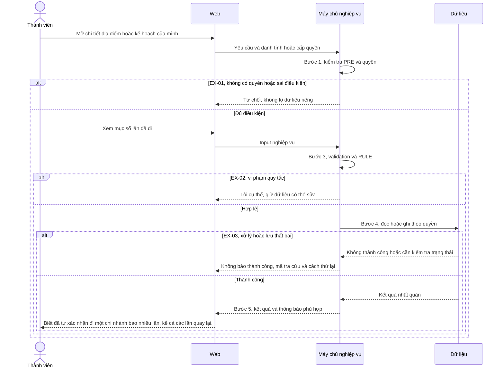

# UC-027: Xem số lần đã đi tại địa điểm

**Version:** 1.1 — 15-11-2026  
**Status:** Draft, chờ duyệt nghiệp vụ; chưa tự coi các PROP/TBD là baseline.  
**Requirement chính:** [GWB-REQ-G1 v1.1](../requirements/GoWithBae_Requirements_G1_v1.1.md)  
**Nguồn khách hàng:** CR-001 ngày 15-11-2026, kế thừa tự xác nhận ở §5.3  
**Truy vết:** FR-35, FR-22; AC-053, AC-054.

## 1. Overview

| Trường | Nội dung |
|---|---|
| Goal | Biết đã tự xác nhận đi một chi nhánh bao nhiêu lần, kể cả các lần quay lại. |
| Primary Actor | Thành viên |
| Secondary Actors | Máy chủ GoWithBae; dịch vụ email/bản đồ/tệp/lịch chỉ khi thao tác tương ứng cần tích hợp, theo requirement §7 |
| Trigger | Mở chi tiết địa điểm hoặc kế hoạch của mình |
| Scope IN | Xem số lần đã đi tại địa điểm trên web G1 theo các FR liên kết |
| Scope OUT | Chức năng G2, đặt chỗ/thanh toán/app/AI/chat; quyền và thao tác ngoài mục tiêu UC. Điều hướng sang UC khác không tự thực hiện UC đó. |

## 2. Preconditions

- PRE-1: Đã đăng nhập vào tài khoản của chính mình; số lần là dữ liệu cá nhân, không cấp qua link của người khác. Enforce tại bước 1; kiểm tra lại quyền/trạng thái liên quan tại bước 3–4 trước khi trả dữ liệu hoặc ghi.
- PRE-2: Các lượt được tính phải có xác nhận Đã đi hợp lệ; plan chưa đi, bỏ qua nhắc hoặc khách xem link không tạo lượt cá nhân. Enforce tại bước 1; kiểm tra lại quyền/trạng thái liên quan tại bước 3–4 trước khi trả dữ liệu hoặc ghi.

## 3. Postconditions

- POST-1: Đúng tài khoản thấy X lượt hợp lệ của đúng chi nhánh; số tăng theo lượt quay lại thực sự được tự xác nhận, không theo click hay ngày liên tiếp. Được tạo tại bước 4 và phản hồi tại bước 5.
- POST-2: Quyền riêng tư/phạm vi được giữ; không thay dữ liệu ngoài mục tiêu hoặc thông báo thành công khi bước 4 thất bại. Enforce bước 1, 3–5 và EX-01–04.
- Nếu use case thất bại: không ghi kết quả nghiệp vụ dở dang như đã hoàn tất; dữ liệu đã lưu thành công không bị báo chưa lưu chỉ vì lỗi thông báo/analytics sau đó.

## 4. Main Flow

| Bước | Actor | Hành động | System Response |
|---|---|---|---|
| 1 | Thành viên | Mở chi tiết địa điểm hoặc kế hoạch của mình | Kiểm tra tài khoản, quyền dữ liệu cá nhân và mã chi nhánh. |
| 2 | Thành viên | Xem mục số lần đã đi | Xác định các lượt tự xác nhận thuộc đúng tài khoản và đúng chi nhánh. |
| 3 | Thành viên | Yêu cầu số lần hiện tại | Chỉ chọn xác nhận Đã đi hợp lệ; loại plan chưa đi/đã hủy không có xác nhận hợp lệ/dismiss và bản ghi hoặc retry trùng. |
| 4 | Thành viên | Nhận bộ đếm | Tính X từ lượt duy nhất; lần đầu là 1, plan khác đã đi cùng nơi là 2, 3…; không reset theo ngày/tuần. |
| 5 | Thành viên | Đọc Đã đi X lần | Hiển thị số cá nhân ở chi tiết/buổi hẹn; không đưa số này vào nội dung chia sẻ cho khách hoặc coi là chứng nhận G2. |

Các xử lý kiểm tra, truy vấn/ghi, chuyển trạng thái, thông báo và analytics trong cột System Response do hệ thống thực hiện, không do actor tự gán trạng thái/quyền.

## 5. Alternate Flows

**AF-01 — Hướng đi hợp lệ khác:** Tại bước 3, chưa có lượt hợp lệ → bước 4 trả 0, bước 5 hiển thị Đã đi 0 lần hoặc Chưa ghi nhận lần đi nào. Khách chỉ xem địa điểm/link vẫn xem được nội dung công khai nhưng không mở count cá nhân; nếu muốn dữ liệu riêng thì đăng nhập qua UC-004. Đổi/sửa câu trả lời cần chính sách OQ-10/25, không tự tăng thêm.

## 6. Exception Flows

**EX-01 — PRE/quyền không đạt.**
- Trigger: không đạt một trong PRE, danh tính/quyền/cấp quyền hết hiệu lực hoặc tài nguyên không được đọc.
- At step 1 hoặc kiểm tra lại bước 3–4: từ chối và không trả dữ liệu riêng; không chỉ ẩn nút phía client.
- Recovery: với thao tác tài khoản, đăng nhập lại khi cần; với khách nhận link, chỉ cần link/phiên khách hợp lệ, không bắt đăng nhập để xem. Xin mời lại/liên hệ người có quyền rồi bắt đầu bước 1; không lách bằng đổi id.

**EX-02 — Vi phạm đầu vào hoặc quy tắc nghiệp vụ.**
- Trigger: Đổi user_id, không có tài khoản, đếm nhiều lần do cùng plan/retry, dùng visit_answer chưa trả lời/Không hoặc dismissal làm lượt: bị chặn hoặc loại khỏi tổng. Nếu đọc count lỗi, báo chưa tải được thay vì giả tổng bằng 0.
- At step 3; kiểm tra biên/trạng thái lại trước ghi tại bước 4. Không ghi kết quả sai; giải thích trường hoặc điều kiện không đạt.
- Recovery: sửa đầu vào ở bước 2, hoặc nạp trạng thái mới từ bước 1 rồi thử lại; OQ chặn phải được PO quyết định, không tự đặt mặc định.

**EX-03 — Đọc/ghi hoặc tích hợp phục vụ nghiệp vụ thất bại.**
- Trigger: timeout, dịch vụ cần thiết không đáp ứng, thao tác đồng thời làm dữ liệu thay đổi hoặc kết quả ghi chưa rõ.
- At step 4: không trả “thành công” khi chưa có kết quả chắc chắn; hiển thị mã tra cứu và giữ input an toàn có thể dùng lại.
- Recovery: kiểm tra trạng thái hiện tại trước retry thao tác ghi để không tạo lặp; đọc có thể thử lại; lỗi kéo dài chuyển vận hành tra mã. Với tích hợp có fallback cụ thể, dùng AF-01/requirement §7 thay vì tự bịa dữ liệu.

**EX-04 — Phản hồi/side effect sau thành công gặp lỗi.**
- Trigger: mất kết nối khi trả kết quả, lỗi thông báo/email/analytics cần thiết sau khi kết quả nghiệp vụ đã được xác lập.
- At step 5: giữ kết quả đã lưu, không báo sai thành thất bại nghiệp vụ và không lộ bí mật trong log.
- Recovery: tải lại/tra trạng thái; vận hành theo dõi và retry phần gửi/ghi sự kiện với mã chống trùng. Không tự tạo lại đối tượng nghiệp vụ chỉ để gửi lại thông báo.

## 7. Business Rules

Định nghĩa đầy đủ tại requirement chính §5. Quy tắc áp dụng vào bước và handler dưới đây; exception phải giữ đúng hậu điều kiện riêng của UC, không coi mọi lỗi đều rollback thao tác đã hoàn tất.

| Rule ID | Description và xử lý khi vi phạm | Applies At Step / handler |
|---|---|---|
| RULE-14 | Chủ tạo được sửa/hủy, người nhận chỉ xem; kiểm tra quyền tại máy chủ Khi vi phạm: Từ chối sửa/hủy của người khác; không chỉ ẩn nút. Chuyển kế hoạch đã qua giờ: OQ-10 | Bước 1/3–4; EX-01/EX-02/EX-03 |
| RULE-15 | Trạng thái plan, câu trả lời đã đi và trạng thái lời nhắc là ba dữ liệu riêng. Đến giờ hỏi “Đi chưa?”; Bỏ qua chỉ đóng nhắc Khi vi phạm: Không tự gán Không/Có khi bỏ qua, không đổi/hủy lịch hay gợi ý popup; không đổi plan hủy thành qua giờ; không gắn nhãn sử dụng đã xác minh | Bước 1/3–4; EX-01/EX-02/EX-03 |
| RULE-17 | Tài khoản khóa không tạo/sửa; xóa thu hồi phiên/link; hồ sơ không yêu cầu tình trạng quan hệ Khi vi phạm: Chặn thao tác không hợp lệ; chưa tuyên bố xóa dữ liệu hoàn tất khi mới nhận yêu cầu | Bước 1/3–4; EX-01/EX-02/EX-03 |
| RULE-29 | [CONF] Số lần đã đi tăng từ lượt tự xác nhận Đã đi; [DER] đếm theo tài khoản + chi nhánh, một kế hoạch được xác nhận hợp lệ tối đa một lượt, retry không tăng Khi vi phạm: Không đếm theo số lần bấm/nhắc/tạo kế hoạch; Bỏ qua/Chưa trả lời/Không không tăng; dữ liệu bị thay đổi cần tính lại theo OQ-10/25, không tự dùng chuỗi thời gian liên tiếp | Bước 1/3–4; EX-01/EX-02/EX-03 |
| RULE-30 | [CONF] Xem link hợp lệ không cần tài khoản; phiên khách được cấp theo link, không phải đăng nhập. Dữ liệu/thao tác cá nhân cần tài khoản Khi vi phạm: Không redirect sang đăng nhập chỉ để xem link; link hết hạn/thu hồi vẫn chặn. Khách bấm lưu yêu thích được yêu cầu đăng nhập, không cấp quyền xem toàn bộ dữ liệu cá nhân người gửi | Bước 1/3–4; EX-01/EX-02/EX-03 |

## 8. Data Requirements

**Input và validation:**

- place_id: mã chi nhánh đang xem hoặc nơi trong kế hoạch; lịch sử nơi ẩn theo OQ-11.
- user_id: lấy từ tài khoản phía máy chủ, không nhận id người khác để xem count.
- visit_count: số nguyên không âm, tính từ lượt Đã đi hợp lệ không trùng; một plan/người chỉ một lượt; không lấy tổng click/analytics event.

**Output / state:** Đúng tài khoản thấy X lượt hợp lệ của đúng chi nhánh; số tăng theo lượt quay lại thực sự được tự xác nhận, không theo click hay ngày liên tiếp. Dữ liệu nghiệp vụ chi tiết tại requirement §6; giới hạn chưa có số phải theo OQ-21, không tự gán giá trị.

**Sequence diagram:** [file Mermaid](./UC-027-view-visit-count.mermaid).

**State machine:** UC này không thêm vòng đời trạng thái riêng. Nếu tham chiếu một entity có trạng thái, áp dụng state machine ở requirement §7; không tạo trạng thái giả chỉ để vẽ sơ đồ.

## 9. Open Questions

OQ-10, OQ-11, OQ-25

Owner, mốc quyết định và mức chặn được ghi tại requirement §13. UC chỉ được baseline sau khi các câu hỏi ảnh hưởng tới nhánh triển khai đã được trả lời hoặc nhánh đó được PO loại khỏi phạm vi rõ ràng.

## 10. Notes và Acceptance Criteria

- Đây là đặc tả yêu cầu, chưa xây phần mềm; nội dung CR-001 mang nhãn CONF, phần PROP/TBD khác vẫn chưa được duyệt; không có bằng chứng kiểm thử runtime.
- Không chọn framework/API/token cụ thể; task tham chiếu hành vi và validation thay vì khóa giải pháp sớm.
- Source/DER/PROP/TBD tuân quy ước requirement chính; cần đọc OQ trước khi dùng làm input coding agent.

| Mã | Given | When | Then |
|---|---|---|---|
| AC-053 | Tài khoản có hai plan khác nhau tại cùng nơi đều xác nhận Đã đi | mở chi tiết nơi đó | hiển thị Đã đi 2 lần; nơi khác và tài khoản khác không bị cộng |
| AC-054 | Một plan đã được ghi Đã đi và count là 1 | gửi lại xác nhận hoặc tải lại nhiều lần | count vẫn 1, không tăng theo số lần click |

Ngoài các ví dụ Given/When/Then này, QA phải kiểm thử EX-01–04, các RULE áp dụng và boundary sau khi OQ đã được quyết định; danh sách này không thay thế toàn bộ kế hoạch kiểm thử. Các nội dung CR-001 đã CONF, chỉ chi tiết còn mở mới cần OQ.

## Verification Report — UC-027

### Blocking Issues / Open Questions cần unblock

OQ-10, OQ-11, OQ-25

Các OQ có mức chặn ở requirement §13 ảnh hưởng trực tiếp bước 3–4. Không kết luận “ready to code” khi chưa chốt chính sách liên quan.

### Warnings

- Giới hạn input, cấu hình dịch vụ/quyền/retention phải duyệt theo phạm vi; task chưa phải ước lượng ngày công hay giải pháp cuối.
- Sơ đồ diễn tả luồng chính và nhánh lỗi; chi tiết AF/EX bằng văn bản là một phần đặc tả bắt buộc.

### Passed — kiểm tra tài liệu, không phải test hệ thống

- Mỗi PRE có kiểm tra ở bước 1 và kiểm tra lại trước kết quả tại bước 3–4.
- POST-1 có xử lý ở bước 4–5; POST-2 được giữ bởi kiểm tra quyền và EX-01–04.
- RULE có bước áp dụng và handler; AF có điểm quay lại/kết thúc; EX có Recovery.
- Một primary actor và một mục tiêu; không có bước thực thi chức năng G2.
- Trạng thái có điều kiện vào/ra hoặc trạng thái kết thúc có chủ ý; PROP/TBD không được coi là chính sách đã duyệt.
